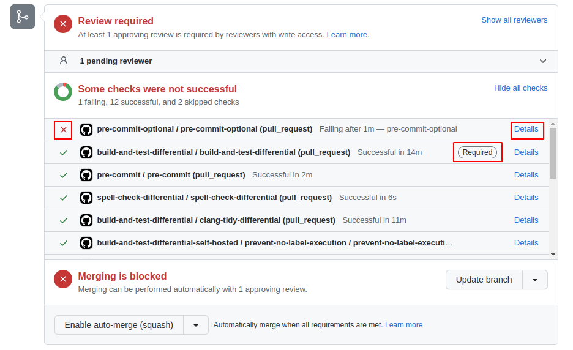

# CI checks

Autoware has several checks for a pull request.
The results are shown at the bottom of the pull request page as below.



If the ❌ mark is shown, click the `Details` button and investigate the failure reason.

If the `Required` mark is shown, you cannot merge the pull request unless you resolve the error.
If not, it is optional, but preferably it should be fixed.

The following sections explain about common CI checks in Autoware.  
Note that some repositories may have different settings.

## DCO

The Developer Certificate of Origin (DCO) is a lightweight way for contributors to certify that they wrote or otherwise have the right to submit the code they are contributing to the project.

This workflow checks whether the pull request fulfills `DCO`.  
You need to confirm the [required items](https://developercertificate.org/) and commit with `git commit -s`.

For more information, refer to the [GitHub App page](https://github.com/apps/dco).

## semantic-pull-request

This workflow checks whether the pull request follows [Conventional Commits](https://www.conventionalcommits.org/en/v1.0.0/).

For the detailed rules, see the [pull request rules](index.md#pull-request-rules).

## pre-commit

[pre-commit](https://pre-commit.com/) is a tool to run formatters or linters when you commit.

This check makes sure that `pre-commit` finds no errors in the pull request.
Most public repositories run it with [pre-commit.ci](https://pre-commit.ci/), which shows the `pre-commit.ci - pr` check.
`autoware_universe` runs it with the `pre-commit-lite` workflow instead.
Private repositories run it with the `pre-commit` workflow.

pre-commit.ci and `pre-commit-lite` fix as many errors as they can and push the fixes to your branch as a `style(pre-commit): autofix` commit.
If some errors remain, fix them manually.

You can run `pre-commit` in your local environment by the following command:

```bash
pre-commit run -a
```

Or you can install `pre-commit` to the repository and automatically run it before committing:

```bash
pre-commit install
```

Since it is difficult to detect errors with no false positives, some jobs are split into another config file and marked as optional.  
To check them, use the `--config` option:

```bash
pre-commit run -a --config .pre-commit-config-optional.yaml
```

### Matching your local clang-format to pre-commit

`pre-commit` uses the clang-format version pinned in `.pre-commit-config.yaml`, so `pre-commit run -a` always matches CI.
Your editor and manual runs use the `clang-format` on your `PATH`, which may be another version and format code differently.

To install the pinned version, take the `rev` of `mirrors-clang-format` in `.pre-commit-config.yaml`, for example `v23.1.1`, and run:

```bash
sudo apt install pipx
pipx ensurepath
pipx install --force clang-format==23.1.1
```

Then open a new terminal and check the version:

```bash
clang-format --version
```

If it still shows another version, log out and log in again.

## spell-check-differential

This workflow detects spelling mistakes using [CSpell](https://github.com/streetsidesoftware/cspell) with [our dictionary file](https://github.com/autowarefoundation/autoware-spell-check-dict/blob/main/.cspell.json).
Since it is difficult to detect errors with no false positives, it is an optional workflow in many repositories, but it is preferable to remove spelling mistakes as many as possible.
Some repositories, such as `autoware_universe`, `autoware_core`, and `autoware_tools`, make it a required check.

You have the following options if you need to use a word that is not registered in the dictionary.

- If the word is only used in a few files, you can use [inline document settings "cspell:ignore"](https://cspell.org/configuration/document-settings/) to suppress the check.
- If the word is widely used in the repository, you can add it to a local `.cspell.json` file and pass the file to the [spell-check action](https://github.com/autowarefoundation/autoware-github-actions/tree/main/spell-check) with the `local-cspell-json` input.
- If the word is common and can be used in many repositories, you can submit pull requests to [autowarefoundation/autoware-spell-check-dict](https://github.com/autowarefoundation/autoware-spell-check-dict) or [tier4/cspell-dicts](https://github.com/tier4/cspell-dicts) to update the dictionary.

## build-and-test-differential

This workflow checks `colcon build` and `colcon test` for the pull request.  
To make the CI faster, it doesn't check all packages but only modified packages and the dependencies.
It builds and tests the packages for both ROS 2 Humble and ROS 2 Jazzy.

The workflow runs only when the pull request has the `run:build-and-test-differential` label.
Without the label, the `require-label` check fails.
Add the label when the pull request is ready for CI. If you cannot add labels, ask a reviewer or a maintainer.

In `autoware_universe`, the `build-test-tidy-pr` workflow runs this check together with related checks:

- `build-and-test-differential-cuda` builds and tests the modified packages with CUDA when the pull request changes the `perception`, `sensing`, or `planning/autoware_diffusion_planner` directories.
- `build-and-test-packages-above-differential` builds the packages in other repositories that depend on the modified packages, for example `autoware_launch` and `autoware_tools`. The `packages_above.repos` file lists these repositories.
- `clang-tidy-differential` runs `clang-tidy` on the changed files of the modified packages after the build succeeds. If the CUDA job runs, `clang-tidy-differential-cuda` does this check instead, in the CUDA environment.

The CUDA and `packages-above` jobs run on self-hosted runners that the Autoware Foundation provides.
For details about self-hosted runners, refer to [GitHub Docs](https://docs.github.com/en/actions/concepts/runners/self-hosted-runners).

## cppcheck-differential

This workflow runs [Cppcheck](https://cppcheck.sourceforge.io/) on the modified packages that contain C++ files.
`autoware_universe` and `autoware_core` use it.

## deploy-docs

This workflow builds the documentation site for every commit of the pull request.  
If the branch of the pull request is in the repository itself, the workflow also publishes a preview and adds a comment with its URL.  
If the branch is in a fork, the workflow uploads the built site as an artifact, because a pull request from a fork gets a read-only token. The summary of the run explains how to download and view the site.

Some repositories still use an older version of this workflow. In these repositories, the preview is built only after a maintainer adds the `run:deploy-docs` label to the pull request.

## comment-docs-artifact

This workflow runs after `deploy-docs` for a pull request from a fork, and adds a comment with the download link of the built site.  
It runs from the default branch and does not run the code of the pull request.
