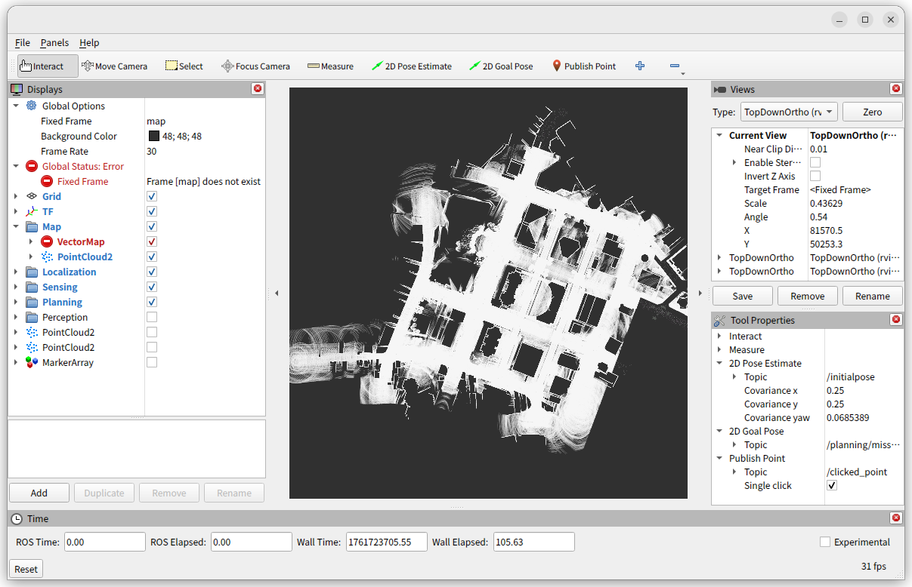
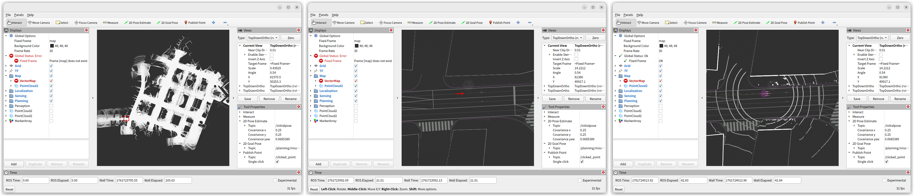
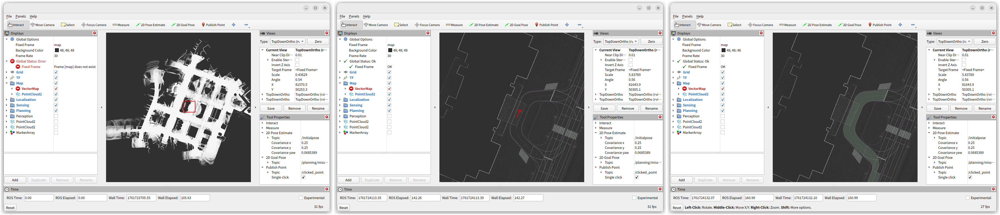

# Autoware Core digital twin simulation with AWSIM

## Installing Autoware

This page describes the procedure for an environment where Autoware Core is already installed.
If you have not yet installed Autoware Core, refer to the [source installation](../../../installation/autoware/core-source-installation.md), the [Docker installation](../../../installation/autoware/core-docker-installation.md), or the [Debian package installation](../../../installation/autoware/core-debian-installation.md) guide.

## Download AWSIM

1. Download following files from [this page](https://autowarefoundation.github.io/AWSIM/Downloads/).
   - AWSIM-Demo.zip
   - Shinjuku-Map.zip

2. Extract the downloaded files. This page assumes the files are placed in the following paths.
   - $HOME/Downloads/AWSIM-Demo
   - $HOME/Downloads/Shinjuku-Map

## Start simulation

1. Launch Autoware according to the section below depending on your installation type.
   - [Launch Autoware for Docker installation](#launch-autoware-for-docker-installation)
   - [Launch Autoware for source installation](#launch-autoware-for-source-installation)
   - [Launch Autoware for Debian Package installation](#launch-autoware-for-debian-package-installation)

   The map will be displayed in Rviz as shown below.
   

2. Launch AWSIM.

   ```bash
   cd $HOME/Downloads/AWSIM-Demo
   ./AWSIM-Demo.x86_64
   ```

   The AWSIM will be displayed as shown below.
   

3. Initialize pose. Select "2D Pose Estimate" and drag the mouse as shown by the arrow.

   

4. Set goal pose. Select "2D Goal Pose" and drag the mouse as shown by the arrow.

   

5. Start autonomous driving. Autoware Core does not include the operation mode manager of Autoware Universe, so publish the operation mode and the gear command by hand. Open a new terminal and set up the same environment that you used to launch Autoware:

   - For a Docker installation, open a shell in the running container and source the setup files:

     ```bash
     docker exec -it autoware-core bash
     source /opt/ros/humble/setup.bash
     source /opt/autoware/setup.bash
     ```

   - For a source installation, source the workspace:

     ```bash
     source $HOME/autoware_core_workspace/install/setup.bash
     ```

   - For a Debian package installation, source ROS 2:

     ```bash
     source /opt/ros/humble/setup.bash
     ```

   Then run these commands:

   ```bash
   ros2 topic pub /system/operation_mode/state autoware_adapi_v1_msgs/msg/OperationModeState \
     "{mode: 2, is_autoware_control_enabled: true, is_autonomous_mode_available: true}" \
     --once --qos-durability transient_local

   ros2 topic pub /control/command/gear_cmd autoware_vehicle_msgs/msg/GearCommand "command: 2" \
     --once --qos-durability transient_local
   ```

## Launch Autoware for Docker installation

1. Run the following command.

   ```bash
   xhost +local:
   docker run --rm -it --name autoware-core --net host -e DISPLAY=$DISPLAY -v $HOME/Downloads/Shinjuku-Map/map:/home/aw/autoware_data/maps ghcr.io/autowarefoundation/autoware:core-humble
   ```

2. Run the following command in the docker container.

   ```bash
   ros2 launch autoware_core autoware_core.launch.xml use_sim_time:=true map_path:=/home/aw/autoware_data/maps vehicle_model:=autoware_sample_vehicle sensor_model:=autoware_awsim_sensor_kit
   ```

## Launch Autoware for source installation

1. Run the following command.

   ```bash
   cd $HOME/autoware_core_workspace
   source install/setup.bash
   ros2 launch autoware_core autoware_core.launch.xml use_sim_time:=true map_path:=$HOME/Downloads/Shinjuku-Map/map vehicle_model:=autoware_sample_vehicle sensor_model:=autoware_awsim_sensor_kit
   ```

## Launch Autoware for Debian Package installation

1. Run the following command.

   ```bash
   source /opt/ros/humble/setup.bash
   ros2 launch autoware_core autoware_core.launch.xml use_sim_time:=true map_path:=$HOME/Downloads/Shinjuku-Map/map vehicle_model:=autoware_sample_vehicle sensor_model:=autoware_awsim_sensor_kit
   ```
