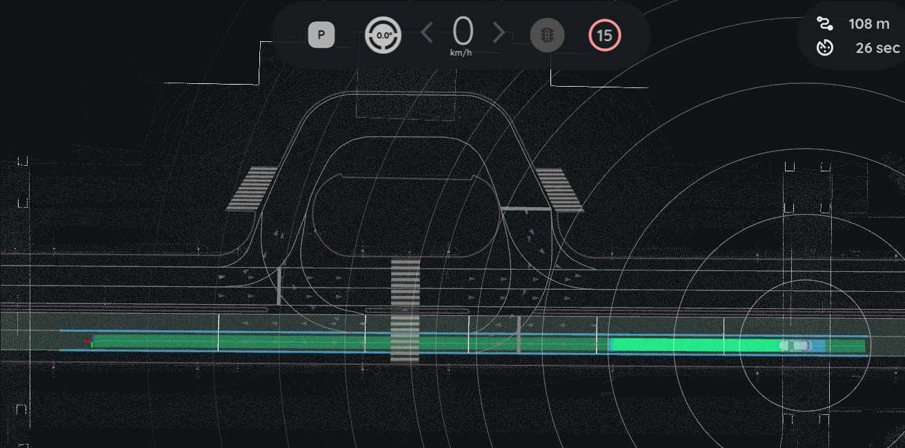
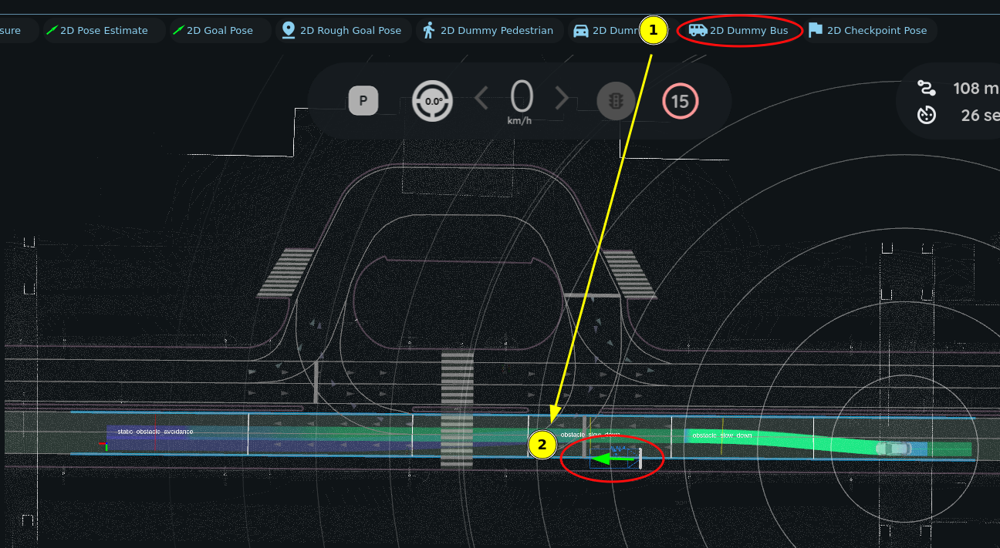
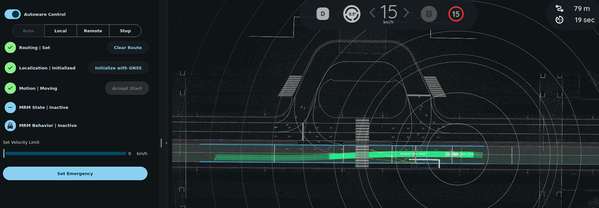

# Avoidance scenario

In this scenario, a bus is parked at the side of the lane. The ego vehicle shifts to the side, passes the bus, and returns to the center of the lane.

The [static obstacle avoidance module](https://autowarefoundation.github.io/autoware_universe/main/planning/behavior_path_planner/autoware_behavior_path_static_obstacle_avoidance_module/) of the behavior path planner plans this path. It avoids objects that stand still, for example parked vehicles.

Launch the planning simulator with the sample map before you start, as described in [Planning simulation](index.md#launch-autoware-planning-simulator).

## Steps

1. Set an initial pose and a goal pose in the same lane. For the steps, see [Lane driving scenario](lane-driving.md). Autoware plans a path along the lane.

   

2. Click the `2D Dummy Bus` button in the toolbar. Click and drag on the roadside of the lane, between the ego vehicle and the goal, to place the bus. Point the bus in the direction of the lane. Autoware plans a new path that goes around the bus.

   

3. Click the `Auto` button in the `AutowareStatePanel`. The ego vehicle follows the new path and avoids the bus.

   

## Where to place the obstacle

The module avoids an object automatically only when it is sure that the object is parked:

- Place the bus near the edge of the lane, not in the center. The module uses the lateral offset of a vehicle from the lane center to decide if the vehicle is parked.
- Keep the velocity of the bus at `0`. The default velocity of the `2D Dummy Bus` tool is `0`. The module does not avoid moving objects.
- Do not place the bus in an intersection. The module assumes that no vehicle parks in an intersection.

If the bus stands near the center of the lane, the module treats it as an ambiguous target. Then the module waits for an operator approval before it avoids the bus, and the ego vehicle stops behind it.

!!! note

    You can also place a `2D Dummy Car` as the obstacle. First set its `Velocity` to `0` in the `Tool Properties` panel, because the default RViz configuration of Autoware sets it to `3` m/s. For the full list of conditions and parameters, see the [static obstacle avoidance module](https://autowarefoundation.github.io/autoware_universe/main/planning/behavior_path_planner/autoware_behavior_path_static_obstacle_avoidance_module/) documentation.
