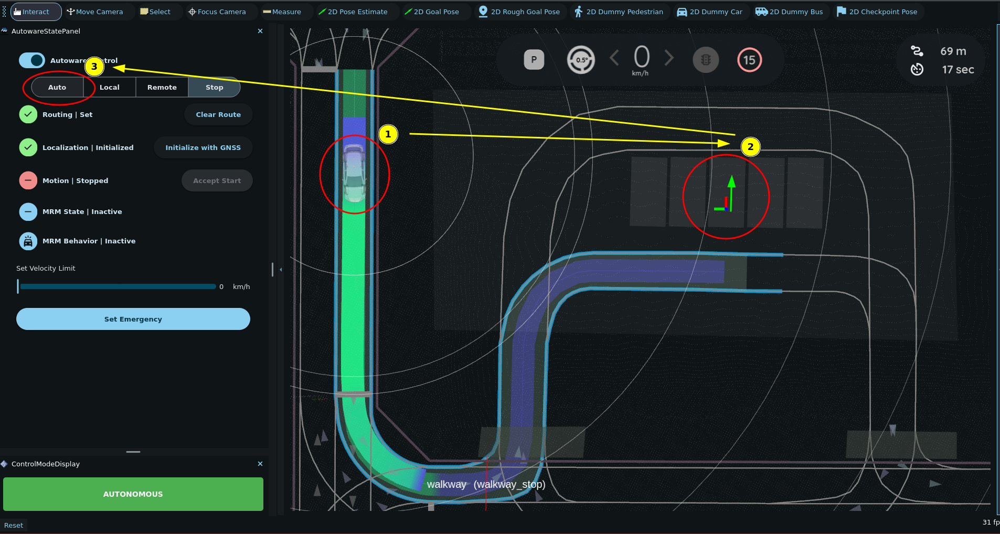
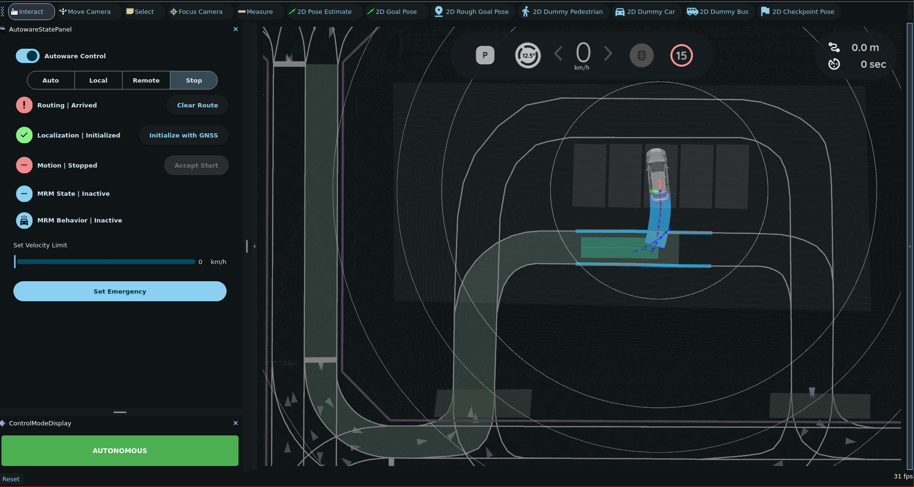

# Parking scenario

In this scenario, the ego vehicle drives on the road to a parking lot and parks in a parking space. The sample map has one parking lot with five parking spaces.

Autoware uses two planning scenarios for this drive:

- The `LaneDriving` scenario follows the lanes of the road.
- The `Parking` scenario plans a free-space path inside the parking lot. The [`autoware_freespace_planner`](https://autowarefoundation.github.io/autoware_universe/main/planning/autoware_freespace_planner/) package makes this path with a hybrid A\* search. The path can have forward and reverse parts.

The [`autoware_scenario_selector`](https://autowarefoundation.github.io/autoware_universe/main/planning/autoware_scenario_selector/) node selects the scenario. It switches to `Parking` when the ego vehicle is in the parking lot, the goal is not on a lane, and the ego vehicle has stopped in autonomous mode.

## 1. Launch Autoware

Launch the planning simulator with the sample map, as described in [Planning simulation](index.md#launch-autoware-planning-simulator).

## 2. Set an initial pose and a goal pose

1. Set an initial pose on a lane near the parking lot. For the steps, see [Lane driving scenario](lane-driving.md#2-set-an-initial-pose-for-the-ego-vehicle).
2. Click the `2D Goal Pose` button in the toolbar, or press the `G` key.
3. In the 3D View pane, click and drag in one of the parking spaces to set the goal pose. The arrow sets the direction of the parked vehicle.

Autoware plans a route on the lanes to the parking lot.

## 3. Engage the ego vehicle

Click the `Auto` button in the `AutowareStatePanel`. Then the drive goes through these stages:

1. The ego vehicle drives on the lanes into the parking lot, and then it stops.
2. The scenario changes from `LaneDriving` to `Parking`. The free-space planner plans a path into the parking space.
3. The ego vehicle maneuvers into the parking space. If the path has a reverse part, the ego vehicle stops and changes the gear before it reverses.

When the ego vehicle reaches the goal, the `Routing` state in the `AutowareStatePanel` changes to `Arrived`.

!!! note

    The parking scenario is enabled by default. The `launch_parking_module` option in the [planning module preset](https://github.com/autowarefoundation/autoware_launch/blob/main/autoware_universe_launch/autoware_planning_config/config/preset/default_preset.yaml) turns it on or off.
