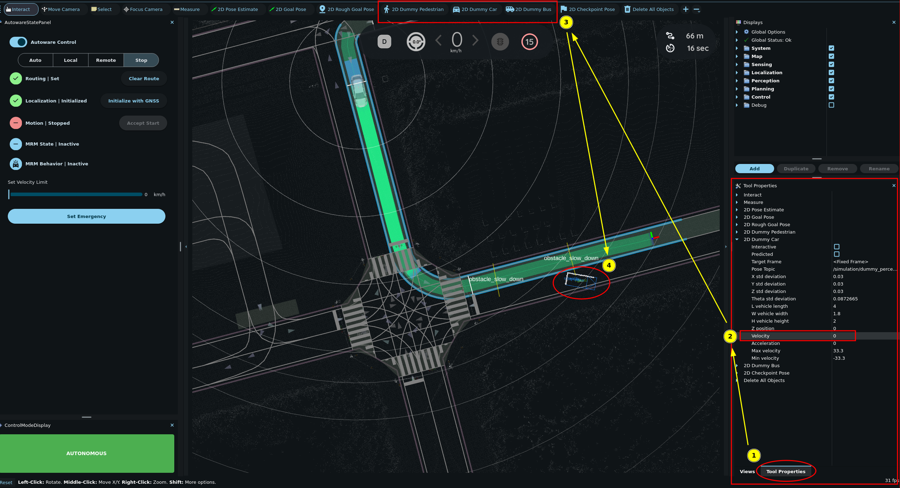
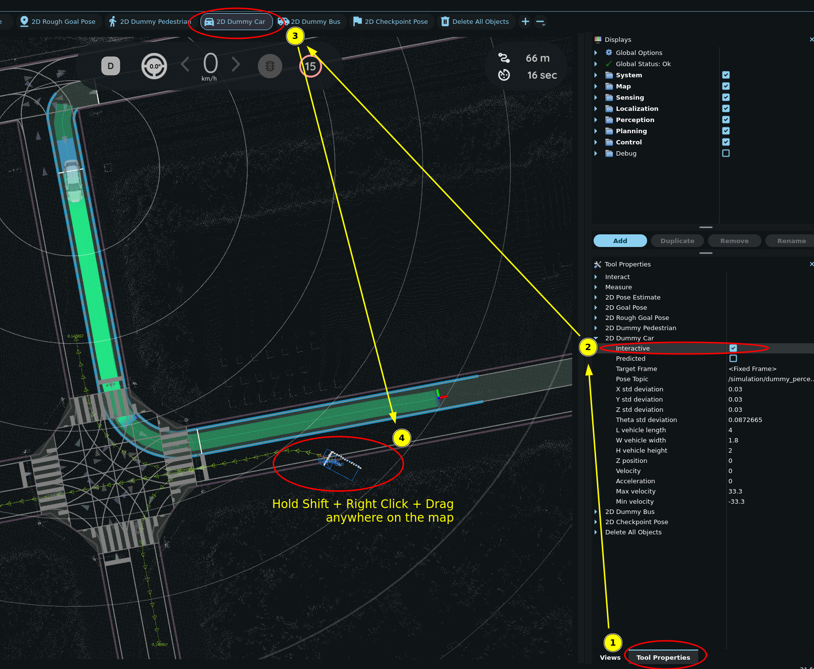

# Placing dummy objects

1. Click the `2D Dummy Car` or `2D Dummy Pedestrian` button in the toolbar.
2. Set the pose of the dummy object by clicking and dragging on the map.
3. Set the velocity of the object in `Tool Properties -> 2D Dummy Car/Pedestrian` panel.

!!! note

    Changes to the `velocity` parameter will only affect objects placed after the parameter is changed.

!!! tip "Delete all dummy objects"

    Click the `Delete All Objects` button in the toolbar and then click anywhere in the 3D View pane to complete it.

## Placing interactive dummy objects

Interactive mode is a property of each dummy object tool. It is off by default.

1. Open the `Tool Properties` panel.
2. Expand the tool of the object type, for example `2D Dummy Car`.
3. Select the `Interactive` checkbox.
4. Click the same tool in the toolbar.

!!! info

    - **Add an interactive dummy object:** ++shift+"🖱️ Right Click"++ on the map.
    - **Delete an interactive dummy object:** ++alt+"🖱️ Right Click"++ on the object.
    - **Move an existing interactive dummy object:** ++"🖱️ Right Click"++ and hold on the object. Then drag and drop it to the desired location.
