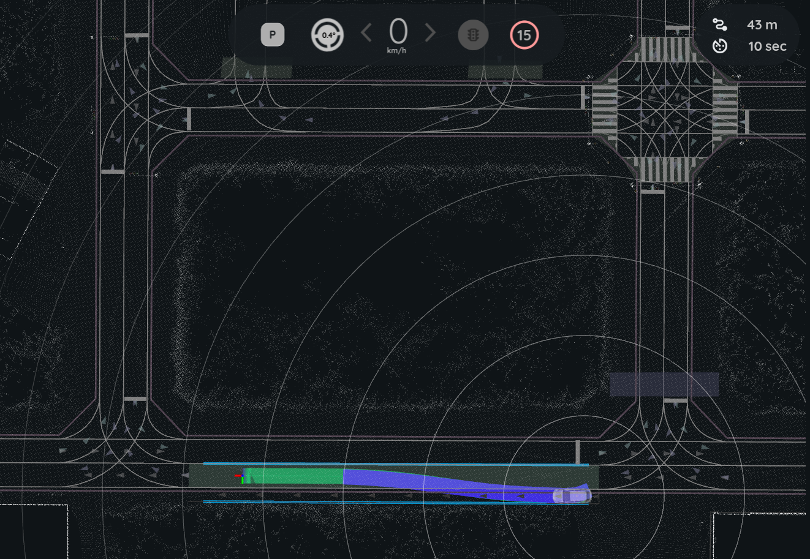

# Pull out and pull over scenario

In this scenario, the ego vehicle starts from the road shoulder and merges into the lane (pull out), or leaves the lane and stops on the road shoulder (pull over). The sample map has one road shoulder lane. The image in the [Pull out](#pull-out) section shows the ego vehicle on it.

Two modules of the behavior path planner plan these maneuvers:

- The [start planner](https://autowarefoundation.github.io/autoware_universe/main/planning/behavior_path_planner/autoware_behavior_path_start_planner_module/) plans the pull out path from the road shoulder into the lane.
- The [goal planner](https://autowarefoundation.github.io/autoware_universe/main/planning/behavior_path_planner/autoware_behavior_path_goal_planner_module/) plans the pull over path from the lane to a goal on the road shoulder.

Launch the planning simulator with the sample map before you start, as described in [Planning simulation](index.md#launch-autoware-planning-simulator).

## Pull out

1. Click the `2D Pose Estimate` button in the toolbar, or press the `P` key.
2. Set the initial pose of the ego vehicle on the road shoulder. Point it in the direction of the lane.

   

3. Click the `2D Goal Pose` button in the toolbar, or press the `G` key. Set a goal on a lane ahead of the ego vehicle.
4. Click the `Auto` button in the `AutowareStatePanel`.

The start planner plans a path from the road shoulder into the lane. The ego vehicle follows this path and then continues to the goal.

!!! note

    The start planner runs only when the ego vehicle is stopped at the side of the road. It does not run when the start pose is in the middle of the lane.

## Pull over

1. Set the initial pose of the ego vehicle on a lane before the road shoulder.
2. Click the `2D Goal Pose` button in the toolbar, or press the `G` key. Set the goal on the road shoulder.
3. Click the `Auto` button in the `AutowareStatePanel`.

When the ego vehicle comes near the goal, the goal planner plans a path from the lane to the road shoulder. The ego vehicle moves to the road shoulder and stops at the goal.

!!! tip "Let Autoware move the goal"

    If you set the goal with `2D Rough Goal Pose` (the `R` key), Autoware can move the goal. Then the goal planner can pull over to the road shoulder near the goal, even when the goal is on a lane. If you set a goal on a lane with `2D Goal Pose`, the ego vehicle stops at the goal in the lane.
