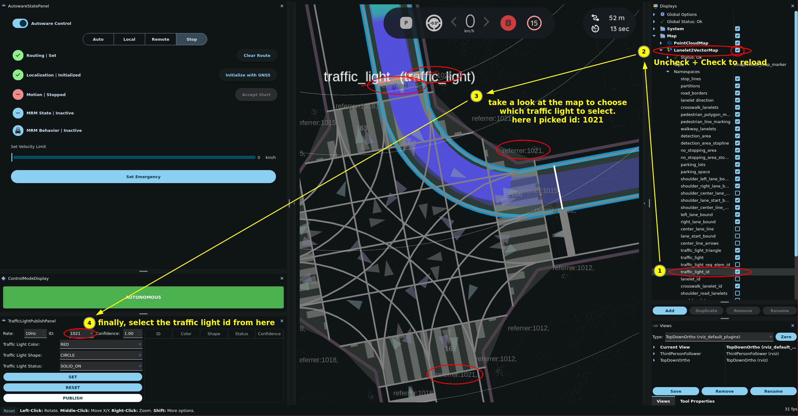
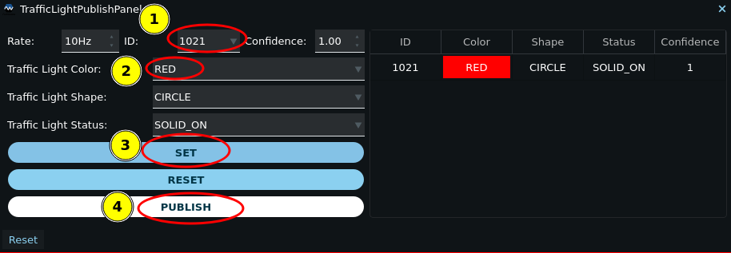
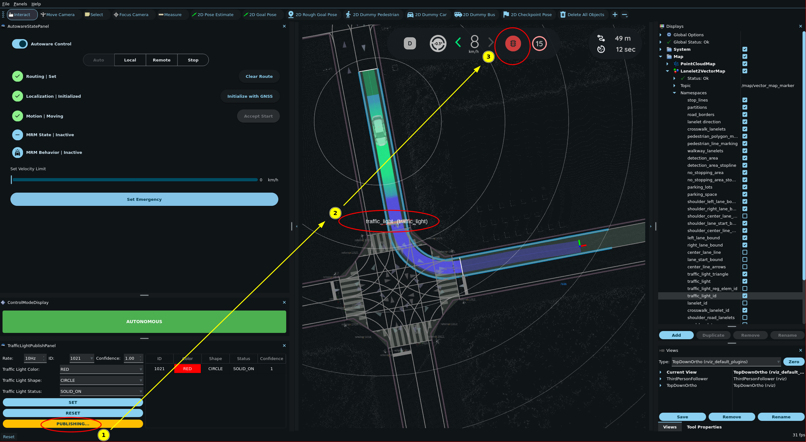
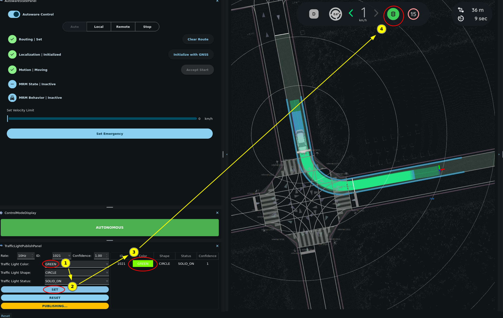

# Traffic light recognition simulation

By default, traffic lights on the map are all treated as if they are set to green. As a result, when a path is created that passed through an intersection with a traffic light, the ego vehicle will drive through the intersection without stopping.

The reason is that the planning simulator does not run traffic light recognition. It runs the [`autoware_dummy_traffic_light_publisher`](https://autowarefoundation.github.io/autoware_universe/main/simulator/autoware_dummy_traffic_light_publisher/) node in its `empty` mode, which publishes no traffic light signals. The traffic light module lets the ego vehicle pass a traffic light that never had a signal.

The following steps explain how to set and reset traffic lights in order to test how the Planning component will respond.

## Set traffic light

By default, Rviz doesn't display the IDs of traffic lights on the map.
To enable the display of traffic light IDs, follow these steps:

1. In the `Displays` panel, find the `traffic_light_id` topic by toggling the triangle icons next to `Map > Lanelet2VectorMap > Namespaces`.
2. Check the `traffic_light_id` checkbox.
3. Reload the topic by clicking the `Map` checkbox twice.
4. Have a closer look at the IDs by zooming in the region or by changing the View type.

1. Go to `Panels -> Add new panel`, select `tier4_traffic_light_rviz_plugin/TrafficLightPublishPanel`, and then press `OK`.

2. In `TrafficLightPublishPanel`, set the `ID` and color of the traffic light.

3. Click the `SET` button.
   

4. Finally, click the `PUBLISH` button to send the traffic light status to the simulator. Any planned path that goes past the selected traffic light will then change accordingly.

## Update/Reset traffic light

You can update the color of the traffic light by selecting the next color (in the image it is `GREEN`) and clicking `SET` button. In the image the traffic light in front of the ego vehicle changed from `RED` to `GREEN` and the vehicle restarted.

To remove a traffic light from `TrafficLightPublishPanel`, click the `RESET` button.

!!! tip "Other traffic light modes"

    The `dummy_traffic_light_mode` argument of `planning_simulator.launch.xml` sets the mode of the dummy traffic light publisher:

    - `empty` (default): Publishes no signals.
    - `standalone`: Cycles all traffic lights of the map through green, yellow, and red.
    - `fixed`: Sets all traffic lights of the map to one color (red by default).

    The dummy traffic light publisher and `TrafficLightPublishPanel` publish on the same topic, `/perception/traffic_light_recognition/traffic_signals`. Use the panel with the default `empty` mode.
