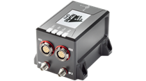
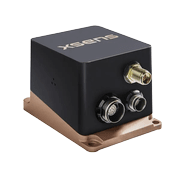
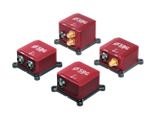
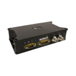
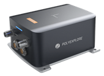
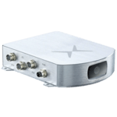

# IMU, AHRS & GNSS/INS

## **NovAtel GNSS/INS Sensors**

NovAtel GNSS/INS sensors which has ROS 2 driver and tested by one or more community members are listed below:

| Supported Products List | INS Rate | Roll, Pitch, Yaw Acc.                  | GNSS                                    | ROS 2 Driver  | Autoware Tested (Y/N) |
| ----------------------- | -------- | -------------------------------------- | --------------------------------------- | ------------- | --------------------- |
| PwrPak7D-E2             | 200 Hz   | R (0.013°) P (0.013°) Y (0.070°) | 20 Hz L1 / L2 / L5  555 Channels  | Y             | -                     |
| Span CPT7               | 200 Hz   | R (0.01°)  P (0.01°)  Y (0.03°)  | 20 Hz  L1 / L2 / L5  555 Channels | Y             | -                     |

Link to ROS 2 driver:  
[https://github.com/swri-robotics/novatel_gps_driver/tree/ros2-devel](https://github.com/swri-robotics/novatel_gps_driver/tree/ros2-devel)

Link to company website:  
[https://novatel.com/products/gnss-inertial-navigation-systems](https://novatel.com/products/gnss-inertial-navigation-systems)

## **XSens GNSS/INS & IMU Sensors**

XSens GNSS/INS sensors which has ROS 2 driver and tested by one or more community members are listed below:

| Supported Products List | INS/IMU Rate | Roll, Pitch, Yaw Acc.            | GNSS                             | ROS 2 Driver  | Autoware Tested (Y/N) |
| ----------------------- | ------------ | -------------------------------- | -------------------------------- | ------------- | --------------------- |
| MTi-680G                | 2 kHz        | R (0.2°) P (0.2°) Y (0.5°) | 5 Hz L1 / L2  184 Channels | Y             | -                     |
| MTi-300 AHRS            | 2 kHz        | R (0.2°) P (0.2°) Y (1°)   | Not Applicable                   | Y             | -                     |

Link to ROS 2 driver:  
[http://wiki.ros.org/xsens_mti_driver](http://wiki.ros.org/xsens_mti_driver)

Link to company website:  
[https://www.xsens.com/](https://www.xsens.com/)

## **SBG GNSS/INS & IMU Sensors**

SBG GNSS/INS sensors which has ROS 2 driver and tested by one or more community members are listed below:

| Supported Products List | INS/IMU Rate        | Roll, Pitch, Yaw Acc.             | GNSS                            | ROS 2 Driver  | Autoware Tested (Y/N) |
| ----------------------- | ------------------- | --------------------------------- | ------------------------------- | ------------- | --------------------- |
| Ellipse-D               | 200 Hz, 1 kHz (IMU) | R (0.1°) P (0.1°) Y (0.05°) | 5 Hz L1 / L2 184 Channels | Y             | Y                     |
| Ellipse-A (AHRS)        | 200 Hz, 1 kHz (IMU) | R (0.1°) P (0.1°) Y (0.8°)  | Not Applicable                  | Y             | -                     |

Link to ROS 2 driver:  
[https://github.com/SBG-Systems/sbg_ros2_driver](https://github.com/SBG-Systems/sbg_ros2_driver)

Link to company website:  
[https://www.sbg-systems.com/ellipse-series/](https://www.sbg-systems.com/ellipse-series/)

## **Applanix GNSS/INS Sensors**

  <!-- cspell: ignore  POSLV  POLYNAV -->

Applanix GNSS/INS sensors which has ROS 2 driver and tested by one or more community members are listed below:

| Supported Products List | INS/IMU Rate | Roll, Pitch, Yaw Acc.               | GNSS                         | ROS 2 Driver  | Autoware Tested (Y/N) |
| ----------------------- | ------------ | ----------------------------------- | ---------------------------- | ------------- | --------------------- |
| POSLVX                  | 200 Hz       | R (0.03°) P (0.03°) Y (0.09°) | L1 / L2 / L5 336 Channels | Y             | Y                     |
| POSLV220                | 200 Hz       | R (0.02°) P (0.02°) Y (0.05°) | L1 / L2 / L5 336 Channels | Y             | Y                     |

Link to ROS 2 driver:  
[http://wiki.ros.org/applanix_driver](http://wiki.ros.org/applanix_driver)

Link to company website:  
[https://applanix.trimble.com/en/products/hardware/applanix-pos-lv](https://applanix.trimble.com/en/products/hardware/applanix-pos-lv)

## **PolyExplore GNSS/INS Sensors** <!-- cspell: ignore  PolyExplore -->

PolyExplore GNSS/INS sensors which has ROS 2 driver and tested by one or more community members are listed below:

| Supported Products List | INS/IMU Rate | Roll, Pitch, Yaw Acc.                 | GNSS                    | ROS 2 Driver  | Autoware Tested (Y/N) |
| ----------------------- | ------------ | ------------------------------------- | ----------------------- | ------------- | --------------------- |
| POLYNAV 2000P           | 100 Hz       | R (0.01°) P (0.01°) Y (0.1°)    | L1 / L2 240 Channels | Y             | -                     |
| POLYNAV 2000S           | 100 Hz       | R (0.015°) P (0.015°) Y (0.08°) | L1 / L2 40 Channels  | Y             | -                     |

Link to ROS 2 driver:  
[https://github.com/polyexplore/ROS2_Driver](https://github.com/polyexplore/ROS2_Driver)

Link to company website:  
[https://www.polyexplore.com/](https://www.polyexplore.com/)

## **Fixposition Visual GNSS/INS Sensors** <!-- cspell: ignore  Fixposition -->

| Supported Products List | INS/IMU Rate | Roll, Pitch, Yaw Acc.            | GNSS            | ROS 2 Driver  | Autoware Tested (Y/N) |
| ----------------------- | ------------ | -------------------------------- | --------------- | ------------- | --------------------- |
| Vision-RTK 2            | 200Hz        | R (0.1°) P (0.1°) Y (0.4°) | 5 Hz L1 / L2 | Y             | -                     |

Link to ROS 2 driver:  
[https://github.com/fixposition/fixposition_driver](https://github.com/fixposition/fixposition_driver)

Link to company website:  
[https://www.fixposition.com/](https://www.fixposition.com/)

Additional utilities:

- Fixposition SDK, which has the GNSS transformation functions: [https://github.com/fixposition/fixposition-sdk](https://github.com/fixposition/fixposition-sdk)
- Miscellaneous utilities (logging, software update, ...): [https://github.com/fixposition/fixposition_utility](https://github.com/fixposition/fixposition_utility)
