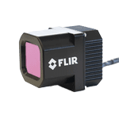

<!-- cspell: ignore Tura -->

# Thermal CAMERAs

A thermal camera measures long-wave infrared (LWIR) light, which is the heat that objects emit. It does not need visible light. As a result, a thermal camera can detect pedestrians and animals by day and at night, also in darkness where an RGB camera sees little.

Autoware 2.0.0 has no perception node that is made for thermal images. To use a thermal camera with Autoware, run a ROS 2 driver that publishes its images as `sensor_msgs/msg/Image` messages. Then connect these images to your own perception nodes, as you do for other cameras. For the camera inputs of Autoware, see [Sensing](../../design/autoware-architecture-v1/components/sensing/index.md).

## **FLIR Thermal Automotive Dev. Kit**

The Teledyne FLIR Automotive Development Kit (ADK) is a thermal camera for advanced driver assistance systems (ADAS) and autonomous vehicles. It has a rugged IP67 enclosure with a heated window, for driving in all weather.

The FLIR ADK thermal cameras are listed below:

| Supported Products List | MP      | FPS      | Interface                          | Spectral Band  | FOV                    | ROS 2 Driver | Autoware Tested (Y/N) |
| ----------------------- | ------- | -------- | ---------------------------------- | -------------- | ---------------------- | ------------ | --------------------- |
| FLIR ADK                | 640x512 | 30 or 60 | GMSL1, GMSL2, USB-C (discontinued) | 8-14 um (LWIR) | 75˚, 50˚, 32˚, and 24˚ | -            | -                     |

The GMSL1 and GMSL2 models need a computer with GMSL inputs or a GMSL frame grabber card. For computers with GMSL inputs, see [AD Computers](ad-computers.md). Teledyne FLIR discontinued the USB-C models and recommends the Tura product line instead.

Link to company website:  
[https://oem.flir.com/products/adk/](https://oem.flir.com/products/adk/)
