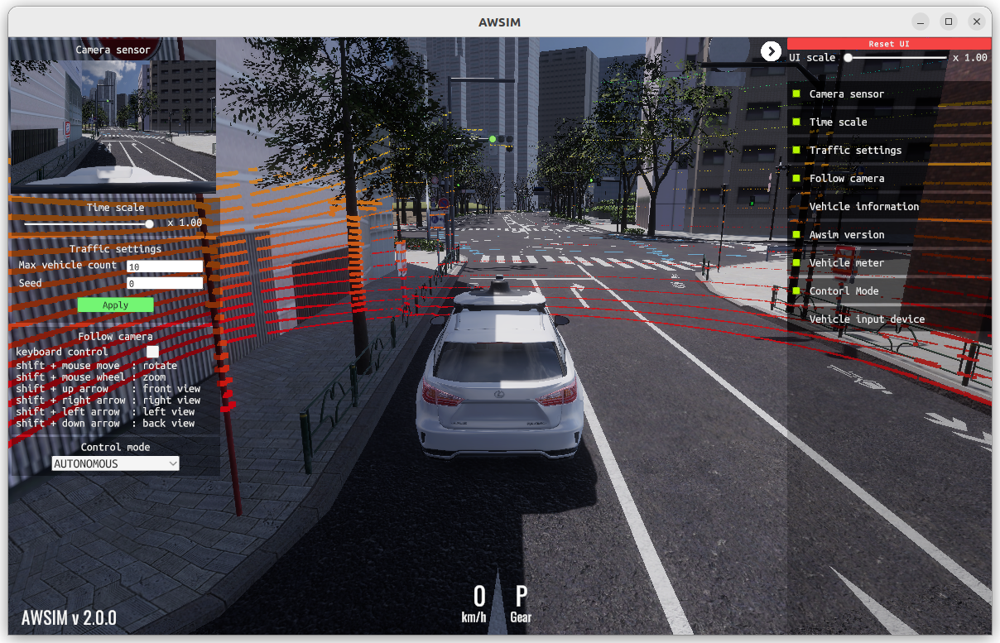
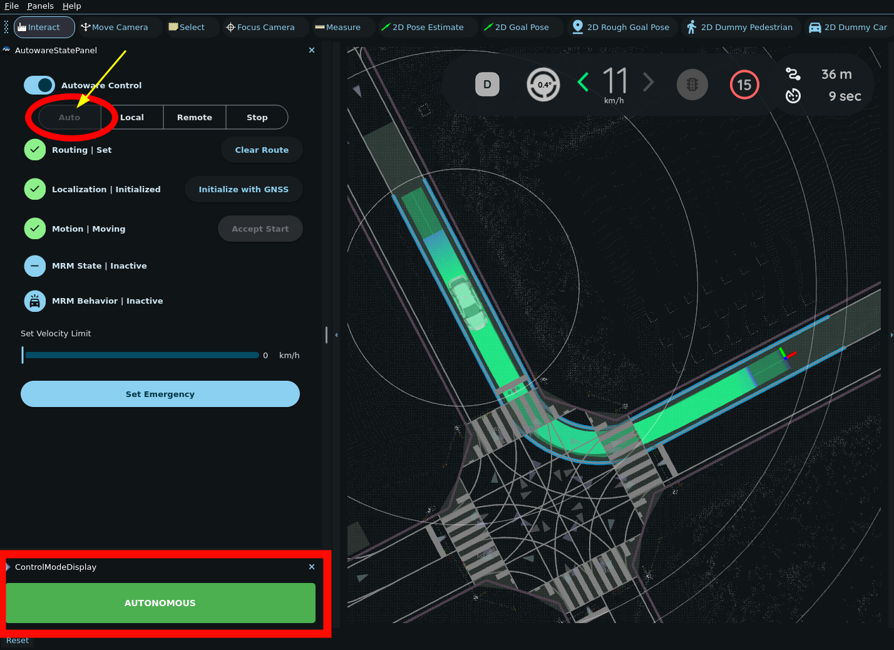
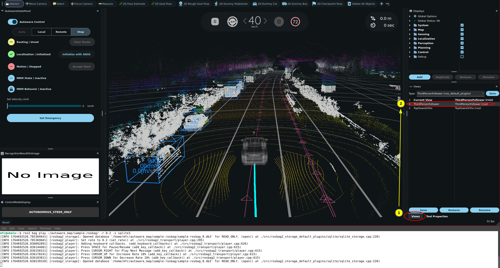
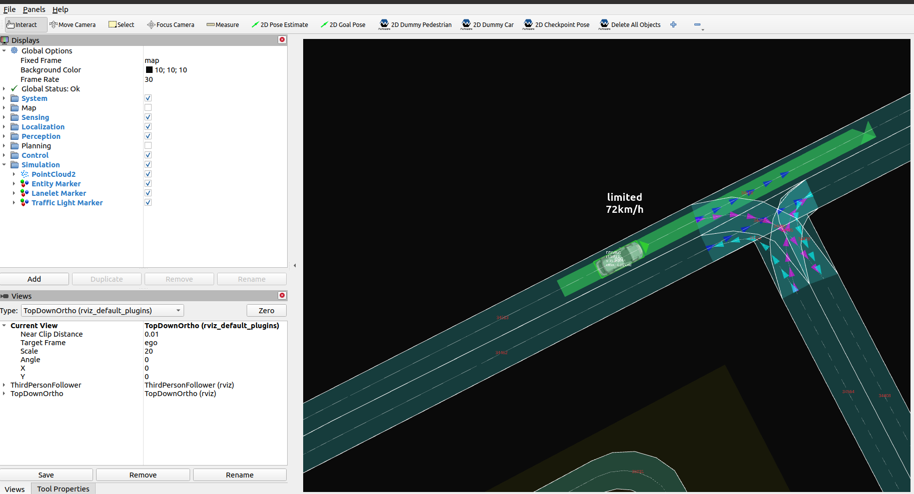

# Simulation

You can run Autoware without a vehicle in four kinds of simulation. Each kind simulates different parts of the vehicle and its world, so it tests different components of Autoware. Choose a simulation by the components that you want to test.

Each page shows how to set up the simulation and how to run Autoware in it. Before you start, [install Autoware](../installation/index.md).

| Simulation                                            |      Sensing       |     Perception     |    Localization    |      Planning      |      Control       |
| :---------------------------------------------------- | :----------------: | :----------------: | :----------------: | :----------------: | :----------------: |
| [Digital twin simulation](#digital-twin-simulation)   | :fa-cl-s fa-check: | :fa-cl-s fa-check: | :fa-cl-s fa-check: | :fa-cl-s fa-check: | :fa-cl-s fa-check: |
| [Planning simulation](#planning-simulation)           |                    |                    |                    | :fa-cl-s fa-check: | :fa-cl-s fa-check: |
| [Rosbag replay simulation](#rosbag-replay-simulation) | :fa-cl-s fa-check: | :fa-cl-s fa-check: | :fa-cl-s fa-check: |                    |                    |
| [Scenario simulation](#scenario-simulation)           |                    |                    |                    | :fa-cl-s fa-check: | :fa-cl-s fa-check: |

{ loading=lazy }

End-to-end

## Digital twin simulation

Tests

All components

All components of Autoware. With another configuration, you can test specific components.

Simulates

- Sensors (Lidar, camera, GNSS/INS, etc.)
- Vehicle dynamics
- NPCs (Non playable characters / other road users & obstacles)

[:fa-cl-s fa-circle-arrow-right: AWSIM](digital-twin-simulation/awsim-tutorial.md){ .md-button .md-button--primary }
[:fa-cl-s fa-circle-arrow-right: AWSIM with Autoware Core](digital-twin-simulation/autoware-core-awsim/index.md){ .md-button }

Other simulators: [MORAI Sim: Drive](digital-twin-simulation/MORAI_Sim-tutorial.md), [CARLA](digital-twin-simulation/carla-tutorial.md), and [PanoSim](digital-twin-simulation/panosim-demo.md). To check that a simulator works with Autoware, run the [compatibility test](digital-twin-simulation/compatibility-test.md).
{ .aw-demo__more }

{ loading=lazy style="object-position: 75% 50%" }

Planning and control

## Planning simulation

Tests

Planning Control

Simulates

- Perception output (bounding boxes)
  - Allows you to place dummy objects and simulate their simple movement
  - Traffic light output
- Localization output
  - Allows you to place the ego vehicle anywhere on the map
- Map output
  - Lets you test the validity of Lanelet2 maps

[:fa-cl-s fa-circle-arrow-right: Planning simulation](planning-simulation/index.md){ .md-button .md-button--primary }

{ loading=lazy style="object-position: 55% 40%" }

Recorded data

## Rosbag replay simulation

Tests

Sensing Perception Localization

These components with the sample rosbag. With your own recorded data, you can test any other component.

Plays back

- Left, right and top lidar output _(in the sample rosbag)_
- GNSS/INS data _(in the sample rosbag)_
- Vehicle status _(in the sample rosbag)_
- Anything else _(based on recorded data)_

[:fa-cl-s fa-circle-arrow-right: Rosbag replay simulation](rosbag-replay-simulation.md){ .md-button .md-button--primary }

{ loading=lazy style="object-position: 80% 50%" }

Scenarios

## Scenario simulation

Tests

Planning Control

Simulates

- Other road users and traffic lights, as an OpenSCENARIO scenario describes them
- Perception output (bounding boxes) and the localization output
- The success and failure conditions of the scenario

[:fa-cl-s fa-circle-arrow-right: Scenario simulation](scenario-simulation/scenario-simulator/installation.md){ .md-button .md-button--primary }

To evaluate Autoware with recorded data and pass or fail criteria, use the [Driving Log Replayer](scenario-simulation/driving-log-replayer.md).
{ .aw-demo__more }

## Evaluation

The [evaluation pages](evaluation/index.md) describe how to measure the quality of Autoware in these simulations: the evaluator packages that calculate metrics while Autoware runs, and an evaluation of the localization in an urban environment.
