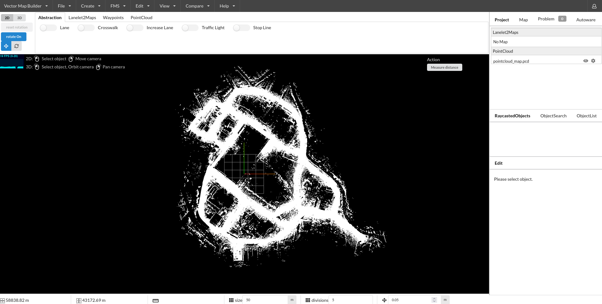
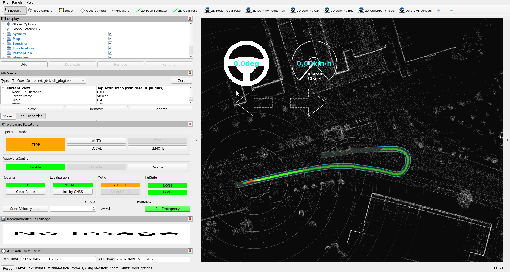

# Creating a Lanelet

At this page, we will explain how to create a simple lanelet on your point cloud map.
If you didn't have a point cloud map before,
please check
and follow the steps on the [LIO-SAM mapping page](../../open-source-slam/lio-sam/index.md)
for how to create a point cloud map for Autoware.

## Creating a Lanelet2

Firstly, we need to import our pointcloud map to Vector Map Builder tool:

1. Please click `File`.
2. Then, click `Import PCD`.
3. Click `Browse` and select your .pcd file.

You will display the point cloud on your Vector Map Builder tool after the upload is complete:

<figure markdown>
  { align=center }
  <figcaption>
    Uploaded pointcloud map file on Vector Map Builder
  </figcaption>
</figure>

Now, we are ready to create lanelet2 map on our pointcloud map:

1. Please click `Create`.
2. Then, click `Create Lanelet2Maps`.
3. Please fill your map name
4. Please fill your MGRS zone. (At tutorial_vehicle, MGRS grid zone: 35T - MGRS 100,000-meter square: PF)
5. Click `Create`.

### Creating a simple lanelet

In order to create a simple lanelet on your map, please follow these steps:

1. Click `Lanelet2Maps` on the bar
2. Enable Lanelet mode via selecting `Lanelet`.
3. Then, you can click the pointcloud map to create lanelet.
4. If your lanelet is finished, you can disable `Lanelet`.
5. If you want to change your lanelet width, click `lanelet` --> `Change Lanelet Width`, then you can enter the lanelet width.

Video Demonstration:


### Join two lanelets

In order to join two lanelets, please follow these steps:

1. Please create two distinct lanelet.
2. Select a Lanelet, then press `Shift` and select other lanelet.
3. Now, you can see `Join Lanelets` button, just press it.
4. These lanelets will be joined.

Video Demonstration:


### Join multiple lanelets

In order to add (join) two or more lanelets to another lanelet, please follow these steps:

1. Create multiple lanelets.
2. You can join the first two lanelets like the steps before.
3. Please check end points ids of first lanelet.
4. Then you need to change these ids with third lanelet's start point. (Please change with selecting linestring of lanelet)
5. You will see two next lanes of the first lanelet will be appeared.

Video Demonstration:


### Change the speed limit of a lanelet

In order to change the speed limit of lanelet, please follow these steps:

1. Select the lanelet where the speed limit will be changed
2. Set `speed limit` on the right panel.

### Test lanelets with planning simulator

After the completing of creating lanelets, we need to save it.
To that please click `File` --> `Export Lanelet2Maps` then download.

After the download is finished,
we need to put lanelet2 map and pointcloud map on the same location.
The directory structure should be like this:

```bash
<YOUR-MAP-DIRECTORY>/
 ├─ pointcloud_map.pcd
 ├─ lanelet2_map.osm
 └─ map_projector_info.yaml
```

The `map_projector_info.yaml` file tells Autoware the projection of the map. Write the MGRS grid that you entered when you created the Lanelet2 map in Vector Map Builder:

```yaml
projector_type: MGRS
vertical_datum: WGS84
mgrs_grid: <YOUR-MGRS-GRID> # for example, 35TPF for tutorial_vehicle
```

Use the vertical datum of your point cloud map. For a point cloud map from the [UTM to MGRS converter](../../converting-utm-to-mgrs-map/index.md), use `EGM2008`. If the file does not exist, Autoware reads the MGRS grid from the Lanelet2 map. This fallback is deprecated.

If your .osm or .pcd map file's name is different from these names,
add the `lanelet2_map_file` and `pointcloud_map_file` arguments to the launch command:

```bash
ros2 launch autoware_launch planning_simulator.launch.xml map_path:=<YOUR-MAP-FOLDER-DIR> vehicle_model:=<YOUR-VEHICLE-MODEL> sensor_model:=<YOUR-SENSOR-KIT> lanelet2_map_file:=<YOUR-LANELET-MAP-NAME>.osm pointcloud_map_file:=<YOUR-POINTCLOUD-MAP-NAME>.pcd
```

Now we are ready to launch the planning simulator:

```bash
ros2 launch autoware_launch planning_simulator.launch.xml map_path:=<YOUR-MAP-FOLDER-DIR> vehicle_model:=<YOUR-VEHICLE-MODEL> sensor_model:=<YOUR-SENSOR-KIT>
```

Example for tutorial_vehicle:

```bash
ros2 launch autoware_launch planning_simulator.launch.xml map_path:=$HOME/autoware_data/maps/tutorial_map/ vehicle_model:=tutorial_vehicle sensor_model:=tutorial_vehicle_sensor_kit vehicle_id:=tutorial_vehicle
```

1. Click `2D Pose Estimate` button on rviz or press `P` and give a pose for initialization.
2. Click `2D Goal Pose` button on rviz or press `G` and give a pose for goal point.

<figure markdown>
  { align=center }
  <figcaption>
    Testing our created vector map with planning simulator
  </figcaption>
</figure>
