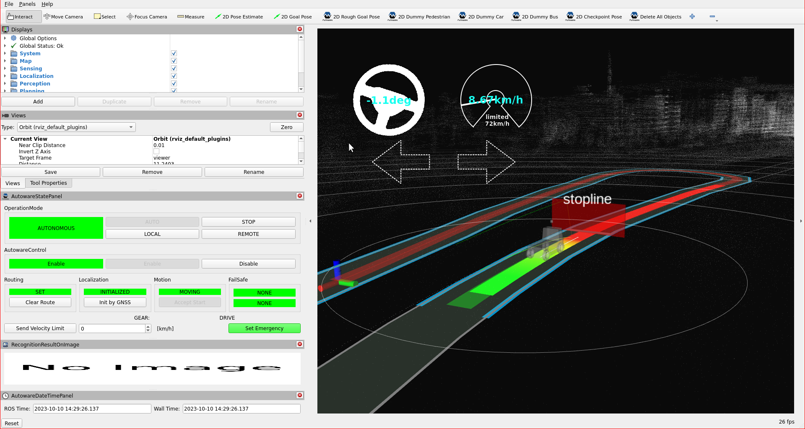

# Stop line

Behavior velocity planner's [stop line module](https://autowarefoundation.github.io/autoware_core/main/planning/behavior_velocity_planner/autoware_behavior_velocity_stop_line_module/) plans velocity
to stop right before stop lines and restart driving after stopped.
In order to operate that, we will add stop line attribute to our lanelet2 map.

## Creating a stop line regulatory element

In order to create a stop line on your pointcloud map, please follow these steps:

1. Please select lanelet which stop line to be added.
2. Click `Abstraction` button on top panel.
3. Select `Stop Line` from the panel.
4. Click on the desired area for inserting stop line.

You can see these steps in the stop line creating demonstration video:


### Testing created the stop line element with planning simulator

After the completing of creating the map, we need to save it.
To that please click `File` --> `Export Lanelet2Maps` then download.

After the download is finished,
we need to put lanelet2 map and pointcloud map on the same location.
The directory structure should be like this:

```text
<YOUR-MAP-DIRECTORY>/
 ├─ pointcloud_map.pcd
 ├─ lanelet2_map.osm
 └─ map_projector_info.yaml
```

The `map_projector_info.yaml` file tells Autoware the projection of the map. Write the MGRS grid that you entered when you created the Lanelet2 map in Vector Map Builder:

```yaml
projector_type: MGRS
vertical_datum: WGS84
mgrs_grid: <YOUR-MGRS-GRID> # for example, 35TPF
```

Use the vertical datum of your point cloud map. For a point cloud map from the [UTM to MGRS converter](../../converting-utm-to-mgrs-map/index.md), use `EGM2008`. If the file does not exist, Autoware reads the MGRS grid from the Lanelet2 map. This fallback is deprecated.

If your .osm or .pcd map file's name is different from these names,
add the `lanelet2_map_file` and `pointcloud_map_file` arguments to the launch command:

```bash
ros2 launch autoware_launch planning_simulator.launch.xml map_path:=<YOUR-MAP-FOLDER-DIR> vehicle_model:=<YOUR-VEHICLE-MODEL> sensor_model:=<YOUR-SENSOR-KIT> lanelet2_map_file:=<YOUR-LANELET-MAP-NAME>.osm pointcloud_map_file:=<YOUR-POINTCLOUD-MAP-NAME>.pcd
```

Now we are ready to launch the planning simulator:

```bash
ros2 launch autoware_launch planning_simulator.launch.xml map_path:=<YOUR-MAP-FOLDER-DIR> vehicle_model:=<YOUR-VEHICLE-MODEL> sensor_model:=<YOUR-SENSOR-KIT>
```

Example for tutorial_vehicle:

```bash
ros2 launch autoware_launch planning_simulator.launch.xml map_path:=$HOME/autoware_data/maps/tutorial_map/ vehicle_model:=tutorial_vehicle sensor_model:=tutorial_vehicle_sensor_kit vehicle_id:=tutorial_vehicle
```

1. Click `2D Pose Estimate` button on rviz or press `P` and give a pose for initialization.
2. Click `2D Goal Pose` button on rviz or press `G` and give a pose for goal point.
3. You can see the stop line marker on the rviz screen.

Stop line markers on rviz:

<figure markdown>
  { align=center }
  <figcaption>
    Stop line test on the created map.
  </figcaption>
</figure>

You can check your stop line elements in the planning simulator as this demonstration video:


