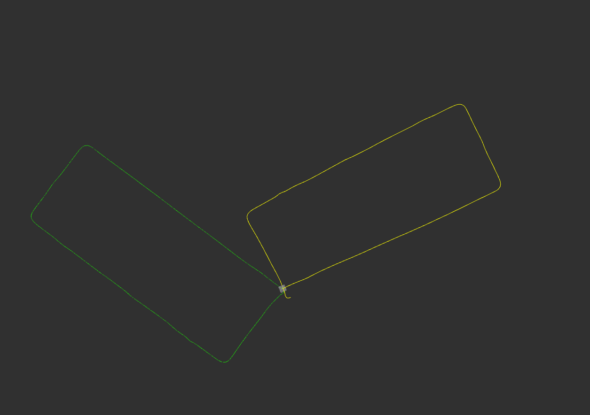
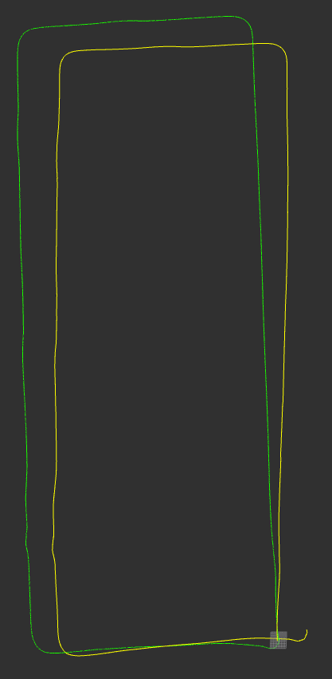
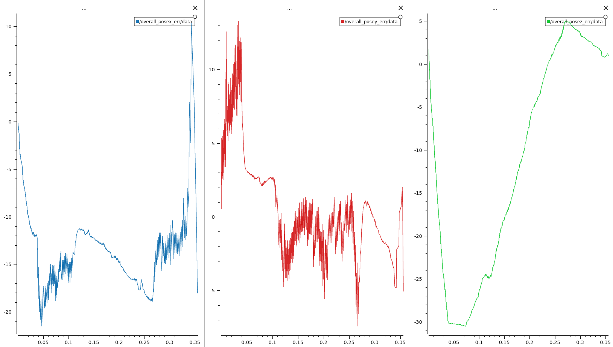
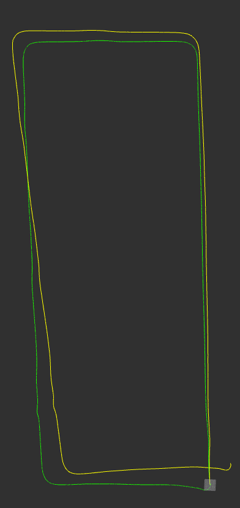
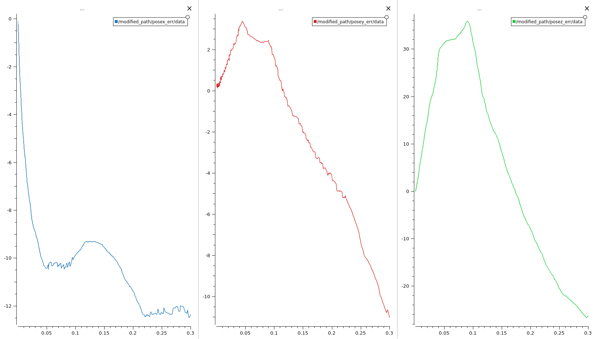

# Open source SLAM algorithms comparison

To evaluate and compare SLAM algorithms, their trajectory errors must be measured in terms of both position and orientation.
This requires a reliable ground-truth trajectory, which can be obtained using a GNSS/INS system.

## Setup

For data collection, we used a mapping kit equipped with a **Velodyne VLP-16 Lidar** and an **Applanix LVX GNSS/INS** unit.
This setup allowed us to record lidar and GNSS/INS data for SLAM and for ground truth simultaneously.
Since the ground truth is expressed in the GNSS/INS reference frame, it must be transformed into the lidar frame for comparison.
The post-processed GNSS/INS solution provides an average positional accuracy of approximately **0.06 meters**.

### Transform

To compute SLAM errors, both the ground-truth trajectory and the SLAM-estimated trajectory must be represented in the same coordinate frame.
Therefore, one trajectory must be rotated and translated to match the other.

The TF tree defining these transformations is shown below:

{{ diagram("images/slam-comparison-tf-tree.svg", "The transforms that bring the GNSS/INS trajectory from the global NED frame into the Velodyne frame.") }}

Transformation matrices are first derived from this tree, and these matrices are then applied to the GNSS/INS positions to align them with the lidar frame.

Before applying the transformation:

## Results

Below are the RViz visualizations of the aligned ground-truth and SLAM trajectories, along with the corresponding position-error plots for each algorithm.

|                          SLAM Algorithm                          |                    Trajectory After Transformation                     |                             Position Error Graphs                              |         Average Position Error (meters)         |
| :--------------------------------------------------------------: | :--------------------------------------------------------------------: | :----------------------------------------------------------------------------: | :---------------------------------------------: |
|    [hdl_graph_slam](https://github.com/koide3/hdl_graph_slam)    |        |  | x: 11.903188   y: 3.887582   z: 13.905123 |
| [lidarslam_ros2](https://github.com/rsasaki0109/lidar_slam_ros2) |  |       | x: 8.949974   y: 2.818557   z: 16.495759  |

## Interpretation

In this test, lidarslam_ros2 has a smaller average error than hdl_graph_slam on the x-axis and on the y-axis. hdl_graph_slam has a smaller average error on the z-axis. For both algorithms, the average error on the z-axis is the largest.

These numbers come from one data set and one sensor setup. Do not use them as a general ranking. Before you select an algorithm, test it with data from your own vehicle and environment.

## Limitations

This comparison has these limitations:

- The alignment does not use ROS TF. The transformation matrices are calculated from the TF tree above and applied to the GNSS/INS positions.
- The SLAM algorithms ran without IMU data.
- The comparison contains only hdl_graph_slam and lidarslam_ros2. The other algorithms on the [list of open-source SLAM implementations](../index.md) are not tested here.
- The comparison measures only the position error. It does not measure the orientation error.
