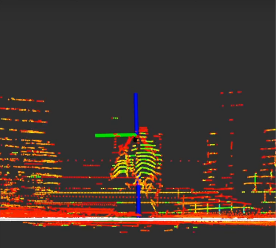
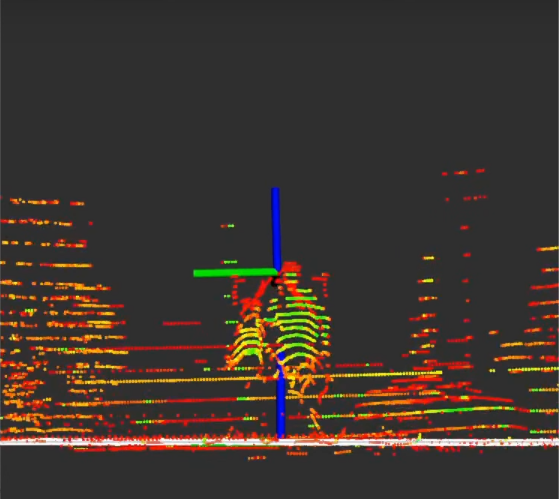

# Ground-Lidar calibration

## Overview

The [ground plane calibrator](https://github.com/tier4/CalibrationTools/tree/tier4/universe/calibrators/ground_plane_calibrator) of TIER IV's CalibrationTools operates under the assumption
that the area surrounding the vehicle can be represented as a flat surface.
So, you must find as wide and flat a surface as possible for ROS 2 bag recording.
The method then modifies the calibration transformation
in a way that aligns the points
corresponding to the ground within the point cloud with the XY plane of the base_link.
This means that only the z, roll, and pitch values of the tf undergo calibration,
while the remaining x, y, and yaw values must be calibrated using other methods,
such as [manual adjustment](../extrinsic-manual-calibration/index.md) or [mapping-based lidar-lidar calibration](../lidar-lidar-calibration/index.md).

You need to apply this calibration method to each lidar separately,
so our bag should contain all lidars to be calibrated.

We need a sample bag file for the ground-lidar calibration process
which includes raw lidar topics.

??? note "ROS 2 Bag example of our ground-based calibration process for tutorial_vehicle"

    ```sh

    Files:             rosbag2_2023_09_05-11_23_50_0.db3
    Bag size:          3.8 GiB
    Storage id:        sqlite3
    Duration:          112.702s
    Start:             Sep  5 2023 11:23:51.105 (1693902231.105)
    End:               Sep  5 2023 11:25:43.808 (1693902343.808)
    Messages:          2256
    Topic information: Topic: /sensing/lidar/front/pointcloud_raw | Type: sensor_msgs/msg/PointCloud2 | Count: 1128 | Serialization Format: cdr
                       Topic: /sensing/lidar/top/pointcloud_raw | Type: sensor_msgs/msg/PointCloud2 | Count: 1128 | Serialization Format: cdr
    ```

## Ground-lidar calibration

### Launching the calibrator

Source your Autoware workspace and start the sensor calibration manager:

```bash
ros2 run sensor_calibration_manager sensor_calibration_manager
```

Select `default_project` as the project and `ground_plane_calibrator` as the calibrator, and click `Continue`.
Then set the launch arguments for the lidar that you calibrate:

| Argument                   | Description                                                                    | Value for tutorial_vehicle          |
| -------------------------- | ------------------------------------------------------------------------------ | ----------------------------------- |
| `base_frame`               | The base frame of the vehicle                                                  | `base_link`                         |
| `lidar_frame`              | The frame of the lidar to calibrate                                            | `rs_helios_top`                     |
| `pointcloud_topic`         | The point cloud topic of this lidar                                            | `/sensing/lidar/top/pointcloud_raw` |
| `use_crop_box_filter`      | Crops the point cloud, so walls and other planes do not disturb the estimation | `true`                              |
| `crop_box_min_x` and other | The limits of the crop box, in meters                                          | The default values (-50.0 to 50.0)  |
| `overwrite_xy_yaw`         | Keeps the x, y, and yaw values of the initial calibration                      | `false`                             |

Click `Launch`.
RViz starts with the calibrator.
You can save your RViz configuration for later use.

The calibrator needs the `tf` of your vehicle and sensors.
The bag does not give it, because the command below remaps the `tf` topics of the bag.
In another terminal, publish the `tf` with `tier4_vehicle_launch`, as on the [manual calibration](../extrinsic-manual-calibration/index.md#checking-the-calibration-in-rviz) page:

```bash
ros2 launch tier4_vehicle_launch vehicle.launch.xml vehicle_model:=<OWN-VEHICLE-MODEL> sensor_model:=<OWN-SENSOR-KIT> launch_vehicle_interface:=false use_sim_time:=true
```

Then play ROS 2 bag file:

```bash
ros2 bag play <rosbag_path> --clock -l -r 0.2 \
--remap /tf:=/null/tf /tf_static:=/null/tf_static # if tf is recorded
```

When the `tf` frames and the calibration service are available, click the `Calibrate` button of the sensor calibration manager.
The calibrator estimates the ground plane in the point cloud and calculates the transformation from `base_frame` to `lidar_frame`.

|          Before Ground Plane - Lidar Calibration           |             After Ground Plane - Lidar Calibration              |
| :--------------------------------------------------------: | :-------------------------------------------------------------: |
|  |  |

The sensor calibration manager shows the result in the `Calibration tree` and `Final TF tree` widgets.
Click `Save calibration` to save the result to a file.
The result is the transformation from `base_link` to the lidar.
If the lidar is a part of your sensor kit, convert the result to the frame of `sensor_kit_base_link` before you write it to `sensor_kit_calibration.yaml`.
Do the calibration again for each lidar.

Here is the video for demonstrating the ground plane - lidar calibration process on tutorial_vehicle.
The video shows an earlier version of CalibrationTools, so the windows look different.


