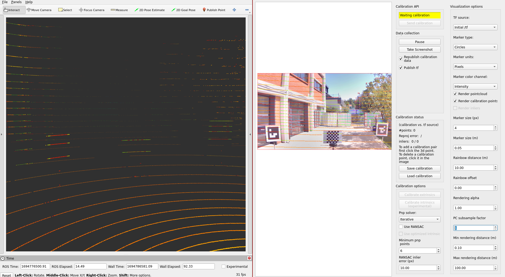
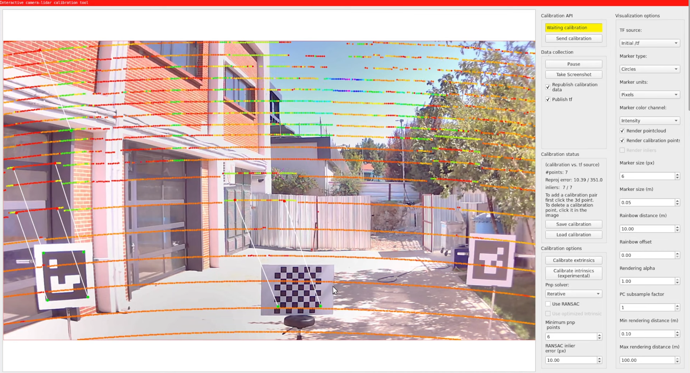
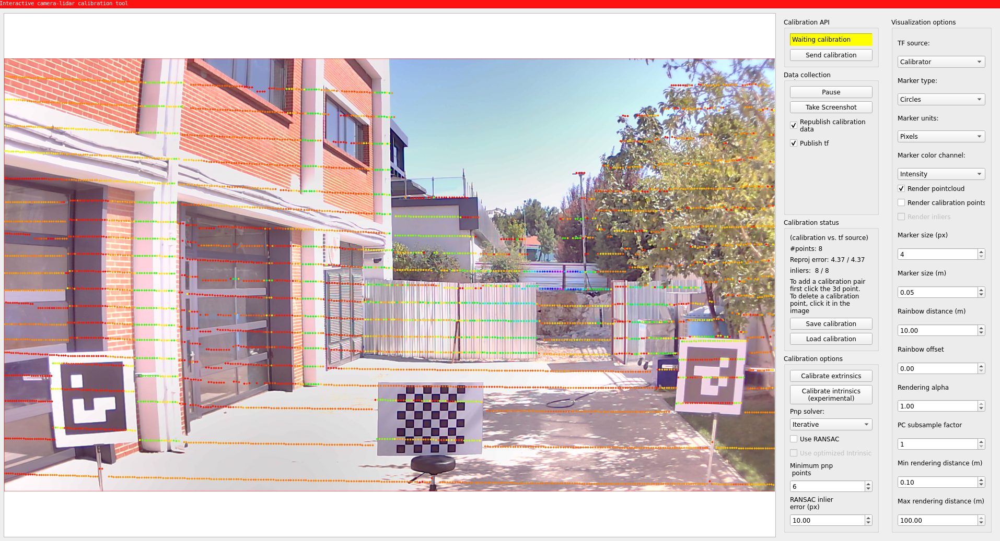

# Lidar-Camera calibration

## Overview

Lidar-camera calibration is a crucial process in the field of autonomous driving and robotics,
where both lidar sensors and cameras are used for perception.
The goal of calibration is
to accurately align the data from these different sensors
in order to create a comprehensive and coherent representation of the environment
by projecting lidar point onto camera image.
At this tutorial,
we will explain [TIER IV's interactive camera-lidar calibrator](https://github.com/tier4/CalibrationTools/tree/tier4/universe/calibrators/interactive_camera_lidar_calibrator).
Also, if you have AprilTag boards for calibration,
the [tag-based PnP calibrator](https://github.com/tier4/CalibrationTools/blob/tier4/universe/docs/tutorials/tag_based_pnp_calibrator.md) of TIER IV's CalibrationTools repository calibrates automatically.

!!! warning

    You need to apply [intrinsic calibration](../intrinsic-camera-calibration/index.md) before starting lidar-camera extrinsic calibration process. Also,
    please obtain the initial calibration results from the [Manual Calibration](../extrinsic-manual-calibration/index.md) section.
    This is crucial for obtaining accurate results from this tool.
    We will utilize the initial calibration parameters that were calculated
    in the previous step of this tutorial.
    To apply these initial values in the calibration tools,
    please update the calibration files in the `config/` folder of your sensor kit description package.

Your bag file must include calibration lidar topic and camera topics.
Camera topics can be compressed or raw topics,
but remember
we will set the `use_compressed` parameter of the interactive calibrator according to the topic type.

??? note "ROS 2 Bag example of our calibration process (there is only one camera mounted) If you have multiple cameras, please add camera_info and image topics as well."

    ```sh

    Files:             rosbag2_2023_09_12-13_57_03_0.db3
    Bag size:          5.8 GiB
    Storage id:        sqlite3
    Duration:          51.419s
    Start:             Sep 12 2023 13:57:03.691 (1694516223.691)
    End:               Sep 12 2023 13:57:55.110 (1694516275.110)
    Messages:          2590
    Topic information: Topic: /sensing/lidar/top/pointcloud_raw | Type: sensor_msgs/msg/PointCloud2 | Count: 515 | Serialization Format: cdr
    Topic: /sensing/camera/camera0/image_raw | Type: sensor_msgs/msg/Image | Count: 780 | Serialization Format: cdr
    Topic: /sensing/camera/camera0/camera_info | Type: sensor_msgs/msg/CameraInfo | Count: 780 | Serialization Format: cdr

    ```

## Lidar-Camera calibration

### Launching the interactive calibrator

The interactive calibrator needs the `tf` of your sensors.
Publish it with `tier4_vehicle_launch`, as on the [manual calibration](../extrinsic-manual-calibration/index.md#checking-the-calibration-in-rviz) page:

```bash
ros2 launch tier4_vehicle_launch vehicle.launch.xml vehicle_model:=<OWN-VEHICLE-MODEL> sensor_model:=<OWN-SENSOR-KIT> launch_vehicle_interface:=false use_sim_time:=true
```

Then start the interactive calibrator in another terminal.
Set the topics and the frames of the camera and the lidar that you calibrate:

```bash
ros2 run interactive_camera_lidar_calibrator interactive_calibrator --ros-args \
  -r pointcloud:=<LIDAR-POINTCLOUD-TOPIC> \
  -r image:=<CAMERA-IMAGE-TOPIC> \
  -r camera_info:=<CAMERA-INFO-TOPIC> \
  -p image_frame:=<CAMERA-OPTICAL-FRAME> \
  -p lidar_frame:=<LIDAR-FRAME> \
  -p use_compressed:=false \
  -p use_calibration_api:=false \
  -p use_sim_time:=true
```

For tutorial vehicle:

```bash
ros2 run interactive_camera_lidar_calibrator interactive_calibrator --ros-args \
  -r pointcloud:=/sensing/lidar/top/pointcloud_raw \
  -r image:=/sensing/camera/camera0/image_raw \
  -r camera_info:=/sensing/camera/camera0/camera_info \
  -p image_frame:=camera0/camera_optical_link \
  -p lidar_frame:=rs_helios_top \
  -p use_compressed:=false \
  -p use_calibration_api:=false \
  -p use_sim_time:=true
```

If your camera topic is a `sensor_msgs/msg/CompressedImage`, set `use_compressed:=true`.
Start `rviz2` and add the point cloud of the lidar.
The calibrator reads the points that you select with the `Publish Point` tool of RViz (the `/clicked_point` topic).

Then, we need to play our bag file.

```bash
ros2 bag play <rosbag_path> --clock -l -r 0.2 \
--remap /tf:=/null/tf /tf_static:=/null/tf_static # if tf is recorded
```

### Lidar-camera calibration process with interactive camera-lidar calibrator

You will see the window of the interactive calibrator and RViz.



- After that, Let's start by pressing the `Publish Point`
  button and selecting points on the point cloud that are also included in the projected image.
  Then,
  you need to click on the image point that corresponds to the projected lidar point on the image.
  You will see matched calibration points.



- The red points indicate selected lidar points and green ones indicate selected image points.
  By default, you must match a minimum of 6 point pairs to perform calibration (you can change this minimum in the window).
  If you have a wrong match, you can remove this match by just clicking on them.
  After selecting points on image and lidar, you are ready to calibrate.
  When you have enough point pairs, the "Calibrate extrinsics" button will be enabled.
  Click this button and change the tf source from `ROS topic (initial)` to `Calibrator` to see calibration results.



After the completion of the calibration,
you need to save your calibration results via the "Save pairs and result" button and select a folder.
The calibrator saves the point pairs and the calibrated transformation from the camera optical frame to the lidar frame in `tf.yaml`.
If you also set the `parent_frame` and `child_frame` parameters (for example `sensor_kit_base_link` and `camera0/camera_link`), it saves the transformation between these two frames in `tf_postprocessed.yaml`.
Then you need
to update the calibration values in `sensor_kit_calibration.yaml` of your `sensor_kit_description` package.

Here is the video
for demonstrating the lidar-camera calibration process on tutorial_vehicle.
The video shows an earlier version of CalibrationTools, so the windows look different.


