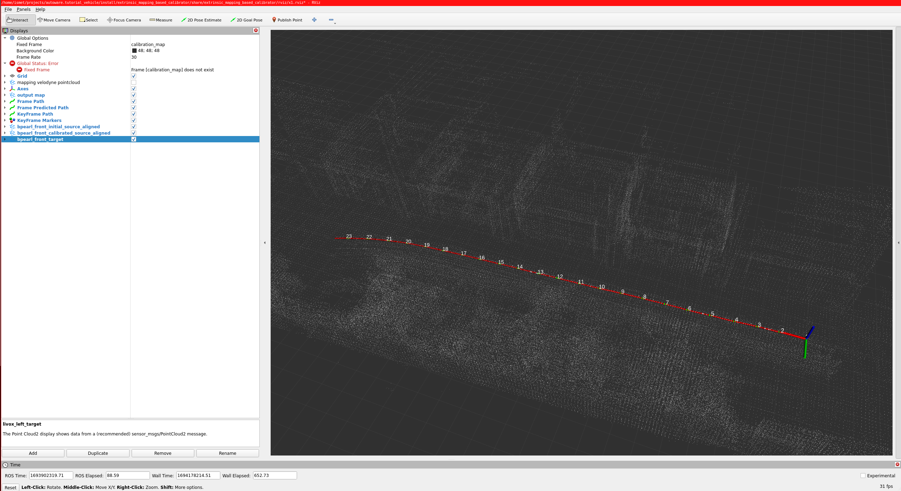
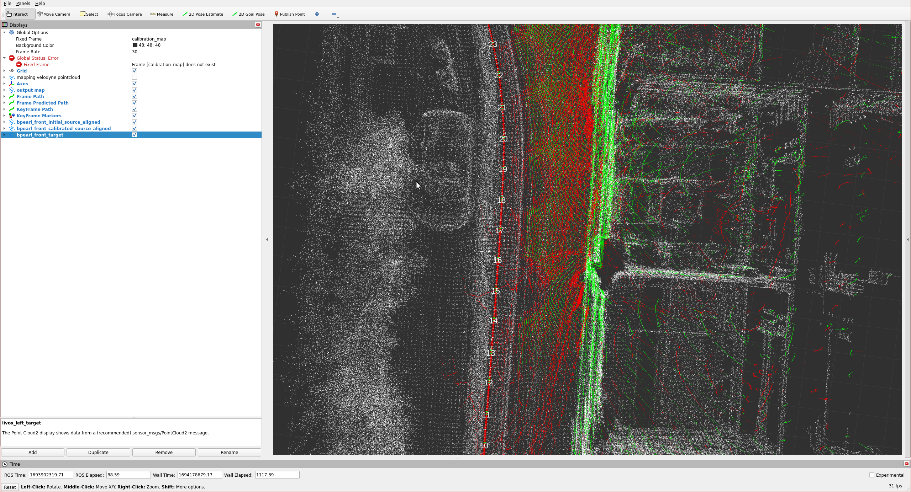

<!-- cspell: ignore registrator -->

# Lidar-Lidar calibration

## Overview

In this tutorial,
we will explain lidar-lidar calibration over the [mapping-based calibrator](https://github.com/tier4/CalibrationTools/blob/tier4/universe/docs/tutorials/mapping_based_calibrator.md) of TIER IV's
CalibrationTools.

!!! warning

    Please obtain the initial calibration results from the [Manual Calibration](../extrinsic-manual-calibration/index.md) section.
    This is crucial for obtaining accurate results from this tool.
    We will utilize the initial calibration parameters that were calculated
    in the previous step of this tutorial.
    To apply these initial values in the calibration tools,
    please update the calibration files in the `config/` folder of your sensor kit description package.

We need a sample bag file for the lidar-lidar calibration process
which includes raw lidar topics.
Also, we recommend using an outlier-filtered
point cloud for mapping because this point cloud
includes a cropped vehicle point cloud. Therefore,
vehicle points are not included in the map. When you start
the bag recording,
you should not move the vehicle for the first 5 seconds for better mapping performance.
The following shows an example of a bag file used for this calibration:

??? note "ROS 2 Bag example of our calibration process for tutorial_vehicle"

    ```sh

    Files:             rosbag2_2023_09_05-11_23_50_0.db3
    Bag size:          3.8 GiB
    Storage id:        sqlite3
    Duration:          112.702s
    Start:             Sep  5 2023 11:23:51.105 (1693902231.105)
    End:               Sep  5 2023 11:25:43.808 (1693902343.808)
    Messages:          2256
    Topic information: Topic: /sensing/lidar/front/pointcloud_raw | Type: sensor_msgs/msg/PointCloud2 | Count: 1128 | Serialization Format: cdr
                       Topic: /sensing/lidar/top/pointcloud | Type: sensor_msgs/msg/PointCloud2 | Count: 1128 | Serialization Format: cdr
    ```

## Mapping-based lidar-lidar calibration

The mapping lidar makes a pointcloud map, and the calibrator registers the point clouds of the other lidars to this map.
The mapping lidar will be used for mapping purposes, but it will not be calibrated.
We can consider this lidar as the main sensor for our hardware architecture.
Therefore, other lidars will be calibrated with respect to the mapping lidar (main sensor).

### Launching the calibrator

Source your Autoware workspace and start the sensor calibration manager:

```bash
ros2 run sensor_calibration_manager sensor_calibration_manager
```

Select `default_project` as the project and `mapping_based_lidar_lidar_calibrator` as the calibrator, and click `Continue`.
Then set the launch arguments for your sensor kit:

| Argument                        | Description                                                   | Value for tutorial_vehicle              |
| ------------------------------- | ------------------------------------------------------------- | --------------------------------------- |
| `mapping_lidar_frame`           | The frame of the mapping lidar                                | `rs_helios_top`                         |
| `mapping_pointcloud`            | The point cloud topic of the mapping lidar                    | `/sensing/lidar/top/pointcloud`         |
| `calibration_lidar_frames`      | The frames of the lidars to calibrate                         | `[rs_bpearl_front]`                     |
| `calibration_pointcloud_topics` | The point cloud topics of the lidars to calibrate, same order | `[/sensing/lidar/front/pointcloud_raw]` |
| `mapping_registrator`           | The registration method of the mapping: `ndt` or `gicp`       | `ndt`                                   |
| `base_frame`                    | The base frame of the vehicle                                 | `base_link`                             |

Click `Launch`.
RViz starts with the calibrator.
You can save your RViz configuration for later use.

The calibrator needs the `tf` of your vehicle and sensors.
The bag does not give it, because the command below remaps the `tf` topics of the bag.
In another terminal, publish the `tf` with `tier4_vehicle_launch`, as on the [manual calibration](../extrinsic-manual-calibration/index.md#checking-the-calibration-in-rviz) page:

```bash
ros2 launch tier4_vehicle_launch vehicle.launch.xml vehicle_model:=<OWN-VEHICLE-MODEL> sensor_model:=<OWN-SENSOR-KIT> launch_vehicle_interface:=false use_sim_time:=true
```

Then play ROS 2 bag file:

```bash
ros2 bag play <rosbag_path> --clock -r 0.2 \
--remap /tf:=/null/tf /tf_static:=/null/tf_static # if tf is recorded
```

When the `tf` frames and the calibration service are available, click the `Calibrate` button of the sensor calibration manager.

### Lidar-lidar calibration process with mapping-based calibrator

The calibration step consists of two phases: mapping and calibration.
At the bag starts playing, then mapping starts as well as the rviz2 screenshot below.



So, red arrow markers indicate poses during mapping,
green arrow markers are special poses taken uniformly,
and white points indicate the constructed map.

Mapping halts either upon reaching a predefined data threshold
or can be prematurely concluded by invoking this service:

```bash
ros2 service call /stop_mapping std_srvs/srv/Empty
```

After the mapping phase of calibration is completed, then the calibration process will start.
After the calibration is completed, then you should rviz2 screen like the image below:



The red points indicate pointcloud that initial calibration results of [previous section](../extrinsic-manual-calibration/index.md).
The green points indicate aligned point (calibration result).

The sensor calibration manager shows the result in the `Calibration tree` and `Final TF tree` widgets.
Click `Save calibration` to save the result to a file.
The result is the transformation from `mapping_lidar_frame` to each lidar in `calibration_lidar_frames`.
Before you write it to `sensor_kit_calibration.yaml`, convert it to the transformation from `sensor_kit_base_link` to the base frame of the lidar (for example `rs_bpearl_front_base_link`). Use the other transformations of your `tf` tree for this conversion.

Here is the video for demonstrating the mapping-based lidar-lidar calibration process on tutorial_vehicle.
The video shows an earlier version of CalibrationTools, so the windows look different.


