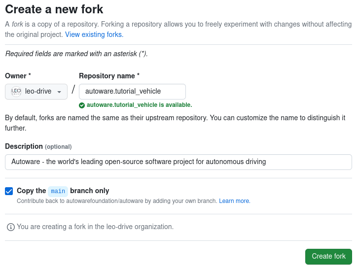

# Creating Autoware repositories

## What is a meta-repository?

A meta-repository is a repository that manages multiple repositories,
and [Autoware](https://github.com/autowarefoundation/autoware) is one of them.
It serves as a centralized control point for referencing, configuring,
and versioning other repositories.
To accomplish this,
the Autoware meta-repository includes the [`repositories/autoware.repos`](https://github.com/autowarefoundation/autoware/blob/2.0.0/repositories/autoware.repos) file
for managing multiple repositories.
We will use the [VCS](https://github.com/ros-infrastructure/vcs2l) tool
(Version Control System) to handle the .repos file.
VCS provides us with the capability to import, export, and pull from multiple repositories.
VCS will be used to import all the necessary repositories to build Autoware into our workspace.
Please refer to the documentation for VCS and .repos file usage.

## How to create and customize your Autoware meta-repository

### 1. Create Autoware meta-repository

If you want to integrate Autoware into your vehicle, the first step is to create an Autoware meta-repository.

One easy way is to fork the Autoware repository and clone it.
(For instructions on how to fork a repository,
refer to [GitHub Docs](https://docs.github.com/en/get-started/quickstart/fork-a-repo))

- In this guide, Autoware will be integrated into a `tutorial_vehicle`
  (Note: when setting up multiple types of vehicles,
  adding a suffix like `autoware.vehicle_A` or `autoware.vehicle_B` is recommended).
  For the first step,
  please visit the [autoware](https://github.com/autowarefoundation/autoware) repository
  and click the fork button.
  The fork process should look like this:

<figure markdown>
  { align=center }
  <figcaption>
    Sample forking demonstration for tutorial_vehicle
  </figcaption>
</figure>

Then click "Create fork" button to continue. After that, we can clone our fork repository on our local system.

```bash
git clone https://github.com/YOUR_NAME/autoware.<YOUR-VEHICLE>.git
```

For example, it should be for our documentation:

```bash
git clone https://github.com/leo-drive/autoware.tutorial_vehicle.git
```

#### 1.1 Create vehicle individual repositories

In Autoware 2.0.0, the sensor kit packages and the vehicle packages are in the [autoware_launch](https://github.com/autowarefoundation/autoware_launch/tree/0.53.0) repository. The separate `sample_sensor_kit_launch`, `sample_vehicle_launch`, and `autoware_individual_params` repositories are archived. To integrate Autoware into your vehicle, fork this repository as well:

- [autoware_launch](https://github.com/autowarefoundation/autoware_launch): This repository contains the launch files and the parameters of Autoware. It also contains these directories for your vehicle:
  - `sensor_kit/`: the sensor kit packages, for example `sample_sensor_kit_launch`. A sensor kit package holds the sensing launch files and the sensor description, including the sensor calibration files.
  - `vehicle/`: the vehicle packages, for example `sample_vehicle_launch`. A vehicle package holds the vehicle interface launch file and the vehicle description, including the vehicle model.

  Fork and rename it like the Autoware meta-repository. In this tutorial, the name of our fork is `autoware_launch.tutorial_vehicle`.

In your fork, add your sensor kit package and your vehicle package. For example, copy `sensor_kit/sample_sensor_kit_launch` to `sensor_kit/tutorial_vehicle_sensor_kit_launch`, and `vehicle/sample_vehicle_launch` to `vehicle/tutorial_vehicle_launch`. Then rename the packages inside them. You can also keep your sensor kit and vehicle packages in separate repositories.

The parameters that change for each vehicle, for example the sensor calibration, are now in the `<sensor_model>_description` package of your sensor kit. If a vehicle needs its own controller parameters, put them in `config/trajectory_follower/<vehicle_id>/` of `autoware_control_config` and set `use_individual_control_param:=true`.

### 2. Customize autoware.repos for your environment

You need to customize your `repositories/autoware.repos` to import your forked repositories.
The `autoware.repos` file usually includes information for all necessary Autoware repositories
(except calibration and simulator repositories).
Therefore, your forked repositories should also be added to this file.

#### 2.1 Adding individual repos to autoware.repos

After you fork the repositories, open the `repositories/autoware.repos` file in a text editor. Replace `autoware_launch` with your fork. For example, in this tutorial, the change for our forked `tutorial_vehicle` repository is:

- Autoware Launch:

  ```diff
    launcher/autoware_launch:
      type: git
  -   url: https://github.com/autowarefoundation/autoware_launch.git
  -   version: 0.53.0
  +   url: https://github.com/YOUR_NAME/autoware_launch.tutorial_vehicle.git
  +   version: main
  ```

If you keep your sensor kit and vehicle packages in separate repositories, add them too:

- Sensor kit and vehicle:

  ```diff
  + sensor_kit/tutorial_vehicle_sensor_kit_launch:
  +   type: git
  +   url: https://github.com/YOUR_NAME/tutorial_vehicle_sensor_kit_launch.git
  +   version: main
  + vehicle/tutorial_vehicle_launch:
  +   type: git
  +   url: https://github.com/YOUR_NAME/tutorial_vehicle_launch.git
  +   version: main
  ```

Make similar changes to your own `repositories/autoware.repos` file. After these changes, you are ready to use VCS to import all the necessary repositories into your Autoware workspace.

First, create a src directory under your own Autoware meta-repository directory:

```bash
cd <YOUR-AUTOWARE-DIR>
mkdir -p src
```

Then, import all necessary repositories with vcs:

```bash
cd <YOUR-AUTOWARE-DIR>
vcs import src < repositories/autoware.repos
```

After the running `vcs import` command,
all autoware repositories will be cloned in the `src` folder under the Autoware directory.

Now, you can build your own repository with colcon build command:

```bash
cd <YOUR-AUTOWARE-DIR>
colcon build --symlink-install --cmake-args -DCMAKE_BUILD_TYPE=Release
```

Please refer to the following documentation links for instructions
on how to create and customize each of your vehicle's packages:

- [Creating vehicle and sensor models](../creating-vehicle-and-sensor-model/index.md)
  - [Creating sensor model](../creating-vehicle-and-sensor-model/creating-sensor-model/index.md)
  - [Sensor calibration files](../creating-vehicle-and-sensor-model/creating-individual-params/index.md)
  - [Creating vehicle model](../creating-vehicle-and-sensor-model/creating-vehicle-model/index.md)
- [creating-vehicle-interface-package](../creating-vehicle-interface-package/ackermann-kinematic-model.md)
- [customizing-for-differential-drive-model](../creating-vehicle-interface-package/customizing-for-differential-drive-model.md)

Please remember to add all your custom packages, such as interfaces and descriptions, to your `repositories/autoware.repos` to ensure that your packages are properly included and managed within the Autoware repository.
