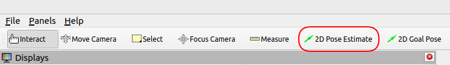
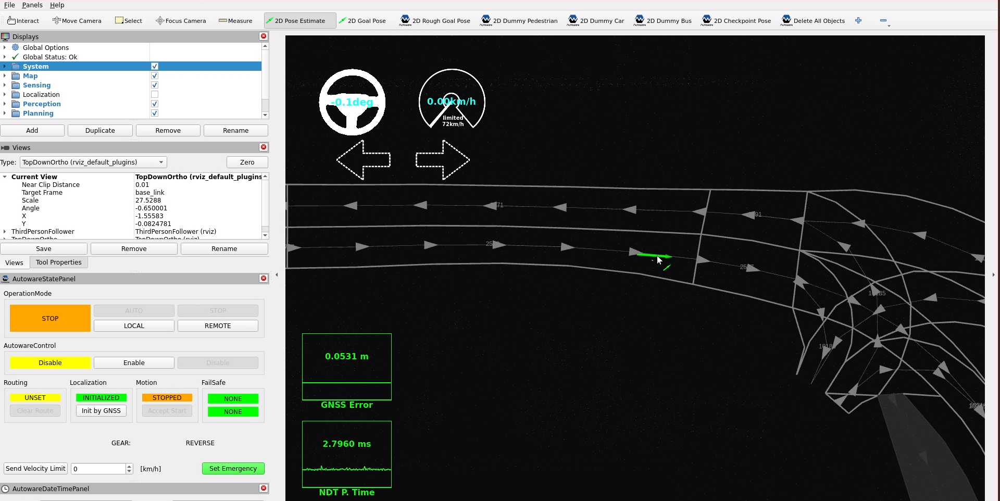
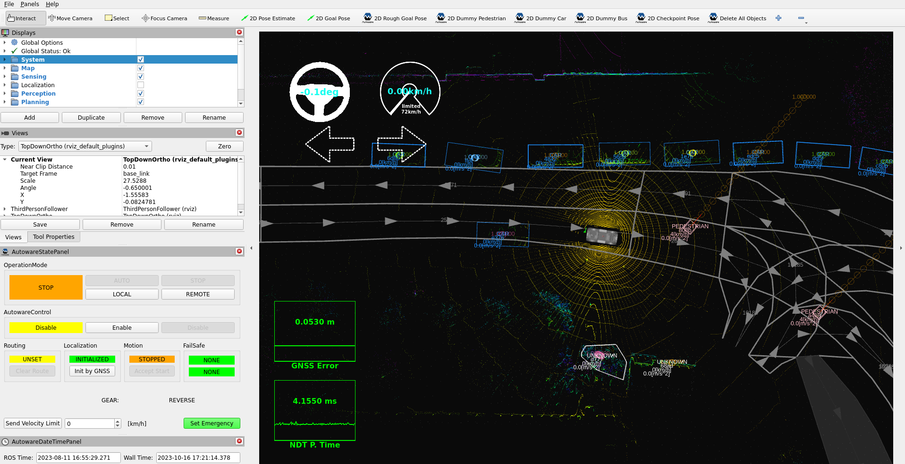
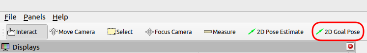
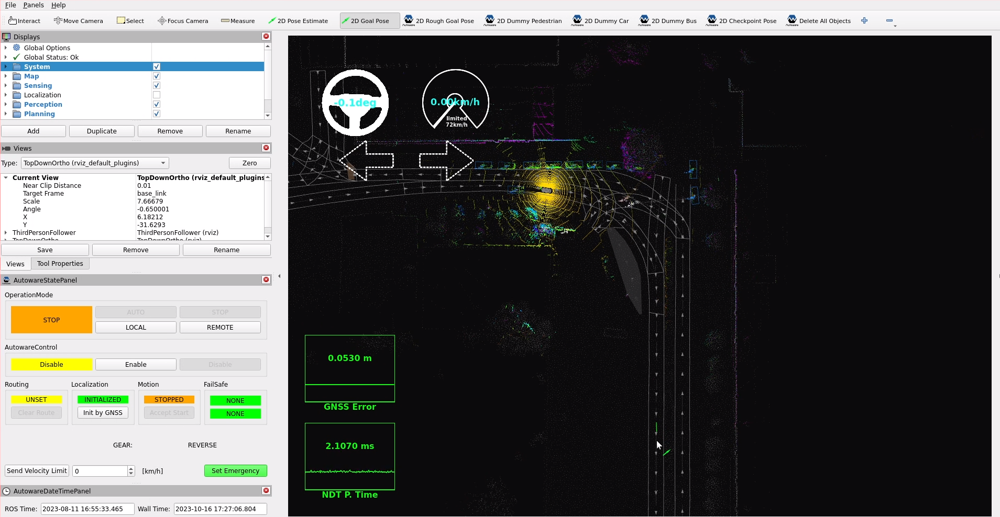
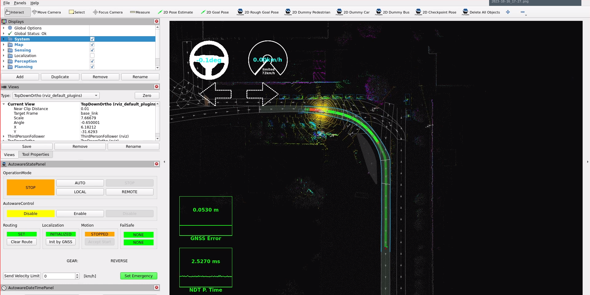
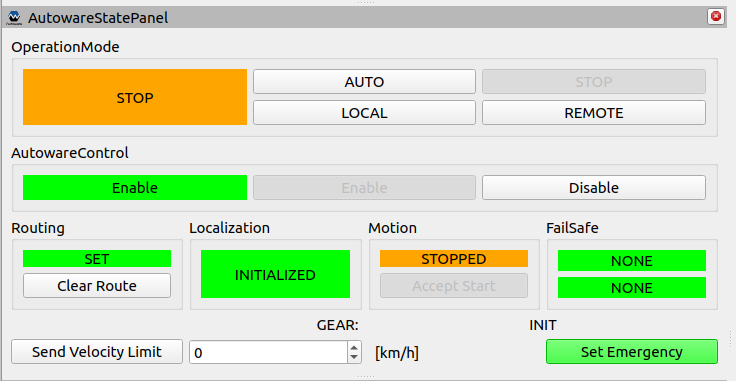
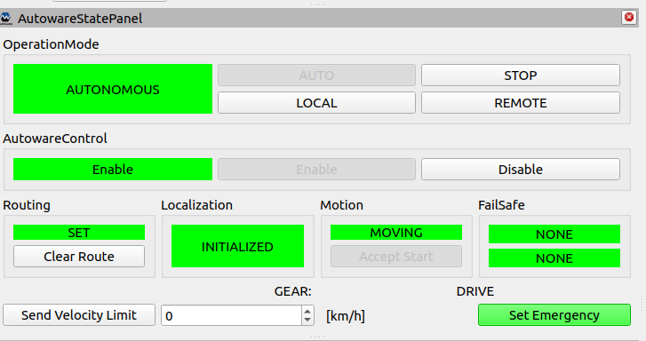

# Launch Autoware

This section explains how to run your vehicle with Autoware. It explains how Autoware launches these components:

- [Vehicle](./vehicle/index.md)
- [System](./system/index.md)
- [Map](./map/index.md)
- [Sensing](./sensing/index.md)
- [Localization](./localization/index.md)
- [Perception](./perception/index.md)
- [Planning](./planning/index.md)
- [Control](./control/index.md)

## Prerequisites for launching Autoware on a real vehicle

Before you launch Autoware on your vehicle, do these steps:

- [Create your Autoware meta-repository](../creating-your-autoware-repositories/creating-autoware-repositories.md).
- [Create your vehicle and sensor model](../creating-vehicle-and-sensor-model/index.md).
- [Calibrate your sensors](../creating-vehicle-and-sensor-model/calibrating-sensors/index.md).
- [Create your Autoware compatible vehicle interface](../creating-vehicle-interface-package/vehicle-interface.md).
- [Create your environment map](../creating-maps/index.md).

When you complete these steps for your vehicle, you are ready to use Autoware.

## autoware_launch package

The [`autoware_launch`](https://github.com/autowarefoundation/autoware_launch/tree/0.53.0) repository holds the launch files and the parameter files of Autoware. Autoware 2.0.0 uses version 0.53.0 of this repository. The top-level launch file is [`autoware.launch.xml`](https://github.com/autowarefoundation/autoware_launch/blob/0.53.0/autoware_launch/launch/autoware.launch.xml) in the `autoware_launch` package. It enables or disables each component with these launch arguments:

```xml
  <arg name="launch_vehicle" default="true" description="launch vehicle"/>
  <arg name="launch_system" default="true" description="launch system"/>
  <arg name="launch_map" default="true" description="launch map"/>
  <arg name="launch_sensing" default="true" description="launch sensing"/>
  <arg name="launch_sensing_driver" default="true" description="launch sensing driver"/>
  <arg name="launch_localization" default="true" description="launch localization"/>
  <arg name="launch_perception" default="true" description="launch perception"/>
  <arg name="launch_planning" default="true" description="launch planning"/>
  <arg name="launch_control" default="true" description="launch control"/>
  <arg name="launch_api" default="true" description="launch api"/>
```

For example, to debug localization, you do not need perception, planning, and control. You can disable these components in your fork of `autoware.launch.xml`:

```diff
-  <arg name="launch_perception" default="true" description="launch perception"/>
+  <arg name="launch_perception" default="false" description="launch perception"/>
-  <arg name="launch_planning" default="true" description="launch planning"/>
+  <arg name="launch_planning" default="false" description="launch planning"/>
-  <arg name="launch_control" default="true" description="launch control"/>
+  <arg name="launch_control" default="false" description="launch control"/>
```

You can also set these arguments on the command line:

```bash
ros2 launch autoware_launch autoware.launch.xml vehicle_model:=YOUR_VEHICLE sensor_model:=YOUR_SENSOR_KIT map_path:=/PATH/TO/YOUR/MAP \
    launch_perception:=false \
    launch_planning:=false \
    launch_control:=false
```

`autoware.launch.xml` starts only RViz and the shared point cloud container itself. For the vehicle, it includes `vehicle.launch.xml` of `tier4_vehicle_launch` directly. For each other component, it includes a component launch file from the [`launch/components`](https://github.com/autowarefoundation/autoware_launch/tree/0.53.0/autoware_launch/launch/components) directory, for example `component_planning.launch.xml`. Most component launch files include the feature launch files of the `autoware_<component>_launch` packages. These launch files read the parameter files of the `autoware_<component>_config` packages. The sensing component includes `sensing.launch.xml` of your sensor kit. The system and the API use the `tier4_<name>_launch` packages. The `autoware_launch` repository has this layout:

```text
<YOUR-AUTOWARE-DIR>/
  └─ src/
       └─ launcher/
            └─ autoware_launch/
                 ├─ autoware_launch/            # autoware.launch.xml, component launch files, RViz configuration
                 │    ├─ config/                # simulator/, system/, and vehicle/ parameter files
                 │    ├─ launch/
                 │    │    └─ components/
                 │    └─ rviz/
                 ├─ autoware_universe_launch/
                 │    ├─ autoware_control_launch/        autoware_control_config/
                 │    ├─ autoware_localization_launch/   autoware_localization_config/
                 │    ├─ autoware_map_launch/            autoware_map_config/
                 │    ├─ autoware_perception_launch/     autoware_perception_config/
                 │    ├─ autoware_planning_launch/       autoware_planning_config/
                 │    ├─ autoware_sensing_launch/
                 │    └─ autoware_sensor_driver_launch/
                 ├─ tier4_universe_launch/
                 │    ├─ tier4_autoware_api_launch/
                 │    ├─ tier4_simulator_launch/
                 │    ├─ tier4_system_launch/
                 │    └─ tier4_vehicle_launch/
                 ├─ sensor_kit/                 # sample_sensor_kit_launch and other sensor kits
                 ├─ vehicle/                    # sample_vehicle_launch and other vehicles
                 └─ autoware_sample_designs/
```

The launch files give the parameter files of the `autoware_<component>_config` packages to the nodes. These values replace the default parameters of the node packages in `autoware_core` and `autoware_universe`. So, to change a parameter, change it in the `autoware_<component>_config` package of your `autoware_launch` fork. The launch files also have a `<component>_config_pkg` argument, for example `control_config_pkg` in `component_control.launch.xml` and `planning_config_pkg` in `planning.launch.xml` of `autoware_planning_launch`. This argument selects another package with the same `config/` layout.

{{ diagram("images/autoware-launch-overview.svg", "autoware_launch starts the components through component launch files and gives the parameter files of the config packages to the nodes.") }}

!!! note

    The [`autoware_sample_designs`](https://github.com/autowarefoundation/autoware_launch/tree/0.53.0/autoware_sample_designs) package shows another way to define and launch Autoware. It describes the system in YAML files, and [Autoware System Designer](https://github.com/autowarefoundation/autoware_system_designer) generates the launch files from them. This tutorial uses `autoware.launch.xml`.

## Configure `autoware.launch.xml`

You can enable or disable the Autoware components in `autoware.launch.xml` or with command-line arguments. `autoware.launch.xml` also has arguments for the configuration of your vehicle. This section shows some of these arguments. You can also use them as command-line arguments.

### Vehicle

In the Vehicle section, you can choose whether the vehicle interface is launched or not. For example, if you disable it, `vehicle.launch.xml` does not include `vehicle_interface.launch.xml`:

```diff
- <arg name="launch_vehicle_interface" default="true" description="launch vehicle interface"/>
+ <arg name="launch_vehicle_interface" default="false" description="launch vehicle interface"/>
```

Make sure that `vehicle_interface.launch.xml` of your vehicle launch package includes your vehicle interface driver. For more information, see the [creating vehicle interface](../creating-vehicle-interface-package/creating-vehicle-interface.md#3-prepare-a-launch-file) page.

### Map

If the names of your point cloud map and your Lanelet2 map are not `pointcloud_map.pcd` and `lanelet2_map.osm`, update these arguments:

```diff
- <arg name="lanelet2_map_file" default="lanelet2_map.osm" description="lanelet2 map file name"/>
+ <arg name="lanelet2_map_file" default="<YOUR-LANELET2-MAP-FILE-NAME>" description="lanelet2 map file name"/>
- <arg name="pointcloud_map_file" default="pointcloud_map.pcd" description="pointcloud map file name"/>
+ <arg name="pointcloud_map_file" default="<YOUR-POINTCLOUD-MAP-FILE-NAME>" description="pointcloud map file name"/>
```

### Perception

The `data_path` argument sets the directory of the machine learning models (the artifacts). The perception, traffic light recognition, and planning launch files read their models from this directory. If you install Autoware with Ansible, it downloads the artifacts to `$HOME/autoware_data/ml_models`. To download the artifacts manually, see the Ansible [`artifacts`](https://github.com/autowarefoundation/autoware/tree/2.0.0/ansible/roles/artifacts) role.

```diff
- <arg name="data_path" default="$(env HOME)/autoware_data/ml_models" description="packages data and artifacts directory path"/>
+ <arg name="data_path" default="<YOUR-AUTOWARE-DATA-PATH>" description="packages data and artifacts directory path"/>
```

Autoware 2.0.0 has no `perception_mode` argument. `component_perception.launch.xml` starts a LiDAR-only object recognition pipeline. The sensor kits of `autoware_launch` have no radars, and object recognition does not use their cameras. For a setup with cameras or radars, your component launch file can include another object recognition launch file of `autoware_perception_launch`, for example `object_recognition_camera_lidar_radar.launch.xml`. For the list of these files, see the [Perception component reference implementation](../../../design/autoware-architecture-v1/components/perception/reference_implementation.md#launch-files).

Traffic light recognition uses a high-accuracy detector by default. The `traffic_light_recognition/use_high_accuracy_detection` argument enables it. For more information, see the [traffic_light_fine_detector](https://autowarefoundation.github.io/autoware_universe/main/perception/autoware_traffic_light_fine_detector/) page. If you do not want to use the high-accuracy detector, disable it. Then Autoware uses the rough detector, which projects the traffic lights of the map into the camera image:

```diff
- <arg name="traffic_light_recognition/use_high_accuracy_detection" default="true" description="enable to use high accuracy detection for traffic light recognition"/>
+ <arg name="traffic_light_recognition/use_high_accuracy_detection" default="false" description="enable to use high accuracy detection for traffic light recognition"/>
```

For more information, see the [Launch perception](./perception/index.md) page.

### Planning and control

The `planning_module_preset` and `control_module_preset` arguments select a module preset file. A preset file enables or disables the planning and control modules. The default value of both arguments is `default`. The `planning_setting` argument selects the source of the trajectory: `rule_based` (the default) or `diffusion_planner`. For more information, see the [Launch planning](./planning/index.md) and [Launch control](./control/index.md) pages.

## Launch Autoware

Launch Autoware with the following command:

```bash
ros2 launch autoware_launch autoware.launch.xml map_path:=<YOUR-MAP-PATH> vehicle_model:=<YOUR-VEHICLE-MODEL> sensor_model:=<YOUR-SENSOR-MODEL> vehicle_id:=<YOUR-VEHICLE-ID>
```

You can specify which components to launch with command-line arguments. For example, to debug localization, you do not need perception, planning, and control:

```bash
ros2 launch autoware_launch autoware.launch.xml map_path:=<YOUR-MAP-PATH> vehicle_model:=<YOUR-VEHICLE-MODEL> sensor_model:=<YOUR-SENSOR-MODEL> vehicle_id:=<YOUR-VEHICLE-ID> \
    launch_perception:=false \
    launch_planning:=false \
    launch_control:=false
```

After you launch Autoware, initialize the pose of the vehicle on the map. If `gnss.launch.xml` of your sensor kit starts [gnss_poser](https://autowarefoundation.github.io/autoware_core/main/sensing/autoware_gnss_poser/) for your GNSS/INS sensor, gnss_poser sends the pose for the initialization. If you do not have a GNSS sensor, set the initial pose manually.

### Set initial pose

If the automatic initialization does not run or gives an incorrect position, set the initial pose with RViz.

- Click the **2D Pose Estimate** button in the toolbar, or press the P key.

<figure markdown>
  { align=center }
  <figcaption>
    2D Pose Estimate button in RViz
  </figcaption>
</figure>

- In the 3D View panel, click and hold the left mouse button. Then drag to set the direction of the initial pose.

<figure markdown>
  { align=center }
  <figcaption>
    Setting the initial pose in RViz
  </figcaption>
</figure>

- Autoware initializes the vehicle. You can then see your vehicle and the outputs of Autoware.

<figure markdown>
  { align=center }
  <figcaption>
    Initialization of the vehicle
  </figcaption>
</figure>

### Set goal pose

Set a goal pose for the ego vehicle.

- Click the **2D Goal Pose** button in the toolbar, or press the G key.

<figure markdown>
  { align=center }
  <figcaption>
    2D Goal Pose button in RViz
  </figcaption>
</figure>

- In the 3D View panel, click and hold the left mouse button. Then drag to set the direction of the goal pose.

<figure markdown>
  { align=center }
  <figcaption>
    Setting the goal pose in RViz
  </figcaption>
</figure>

- If the route is calculated, RViz shows the planned path.

<figure markdown>
  { align=center }
  <figcaption>
    Planned path in RViz
  </figcaption>
</figure>

### Engage

You can engage the vehicle in two ways:

- Use the `AutowareStatePanel`. The Autoware RViz configuration includes it. You can also add it from `Panels > Add New Panel > tier4_state_rviz_plugin > AutowareStatePanel`.

When the route is calculated, the **AUTO** button becomes active. Press the **AUTO** button to start the autonomous driving mode.

<figure markdown>
  { align=center }
  <figcaption>
    Autoware state panel (STOP operation mode)
  </figcaption>
</figure>

- Call the [AD API](../../../design/autoware-architecture-v1/interfaces/ad-api/index.md) service that changes the operation mode. In a terminal, run these commands:

```bash
source ~/<YOUR-AUTOWARE-DIR>/install/setup.bash
ros2 service call /api/operation_mode/change_to_autonomous autoware_adapi_v1_msgs/srv/ChangeOperationMode {}
```

Now the vehicle drives along the planned path.

During autonomous driving, the state panel looks like the image below. To stop the vehicle, press the **STOP** button.

<figure markdown>
  { align=center }
  <figcaption>
    Autoware state panel (AUTO operation mode)
  </figcaption>
</figure>
